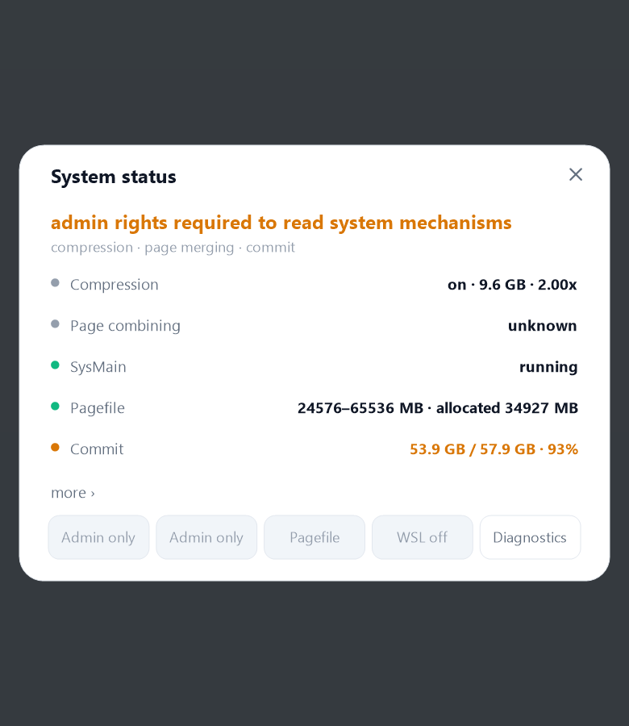
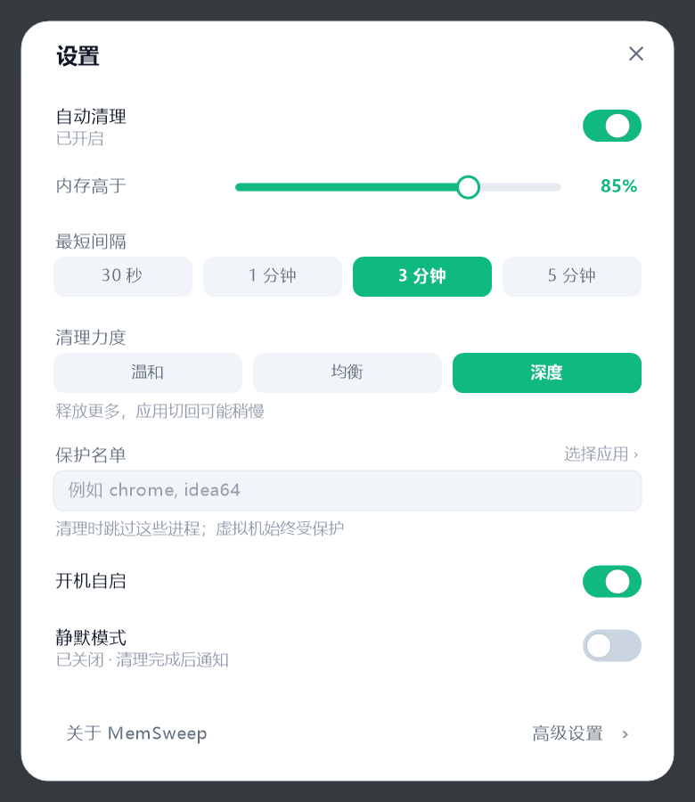

# 内存速清 MemSweep

<p align="center">
  
</p>

<p align="center">
  <strong>A lightweight, intelligent, and safe Windows memory manager.</strong><br>
  轻量、智能、安全的 Windows 原生内存管理与守护工具。
</p>

<p align="center">
  <a href="https://github.com/feiyu-labs/MemSweep/actions/workflows/ci.yml"></a>
  <a href="https://github.com/feiyu-labs/MemSweep/releases/latest"></a>
  <a href="LICENSE"></a>
  
  
  
  
</p>

<p align="center">
  <a href="#-english">English</a> • <a href="#-简体中文">简体中文</a>
</p>

---

<table align="center">
  <tr>
    <th align="center"><b>Light · 简体中文</b></th>
    <th align="center"><b>Dark · 简体中文</b></th>
  </tr>
  <tr>
    <td></td>
    <td></td>
  </tr>
  <tr>
    <th align="center"><b>Light · English</b></th>
    <th align="center"><b>Dark · English</b></th>
  </tr>
  <tr>
    <td></td>
    <td></td>
  </tr>
</table>

---

# 🇬🇧 English

## 💡 Overview

**MemSweep** is a high-performance, ultra-lightweight Windows memory management utility crafted specifically for heavy developer workstations where RAM usage frequently exceeds 85–90%. 

Instead of fighting Windows' internal caching mechanisms, MemSweep synthesizes the best ideas from decades of memory management tools (Mem Reduct, Process Lasso SmartTrim, ISLC, WinMemoryCleaner) into a **safe, tiered, intelligent engine**. It tames runaway background Electron/IDE processes while providing strict immunity to foreground applications, and completely eliminates the crashes, disk write storms, and stuttering caused by legacy tools.

- **Zero Runtime Dependencies**: Pure C++20, Win32, and GDI+. No .NET, no WebView2, no Electron. Single standalone binary (~403 KB x64 / ~339 KB ARM64).
- **Featherweight Resident Footprint**: ~9.5 MB Private Working Set when open (includes 150% DPI double-buffer); drops to **~3.0 MB** when idle in the system tray.
- **Strictly Safe by Design**: **Never** force-flushes modified pages (no SSD wear or freezing), **never** kills processes, and **never** touches your active foreground window.
- **100% Offline & Private**: Zero telemetry, zero network access, and zero background ads.

---

## ⚖️ Why MemSweep? (Comparison Matrix)

| Feature / Metric | MemSweep | Mem Reduct | WinMemoryCleaner | Process Lasso (SmartTrim) | ISLC |
|:---|:---:|:---:|:---:|:---:|:---:|
| **Binary Size** | **~403 KB** (Standalone) | ~350 KB | ~10 MB (.NET) | ~80 MB (Full Suite) | ~1.5 MB |
| **Tray Resident RAM** | **~3.0 MB** (Private WS) | ~4.5 MB | ~35 MB+ | ~45 MB+ | ~18 MB |
| **Foreground App Immunity** | ✅ **Full (Window + Parent + 120s History)** | ❌ None | ❌ None | ⚠️ Exclusion list only | ❌ None |
| **True Depletion Trigger** | ✅ **Yes** (Free < 512MB or Used ≥ 95%) | ❌ Threshold only | ❌ Flawed (Free < 82% freeze loop) | ⚠️ Generic threshold | ⚠️ Standby size only |
| **SSD Write Storm Protection** | ✅ **Guaranteed** (No Modified Page Flush) | ❌ Dangerous Flush | ❌ Dangerous Flush | ✅ Safe | ✅ Safe |
| **Physical Page Deduplication** | ✅ **Native NT Combining** (with Abort) | ❌ None | ❌ None | ❌ None | ❌ None |
| **UI Responsiveness** | ✅ **0 ms** (100% Asynchronous Worker) | ⚠️ Win32 Blocking | ❌ Freezes on heavy load | ✅ Good | ⚠️ WinForms |
| **Modern Fluent UI & Dark Theme** | ✅ **Native Frameless + DWM + Animations** | ❌ Win98/XP Classic | ⚠️ Basic WPF | ❌ Legacy Win32 | ❌ WinForms Classic |
| **Architecture Support** | ✅ **Native x64 + Native ARM64** | ⚠️ x64 / x86 | ⚠️ x64 only | ✅ x64 / ARM64 | ⚠️ x86 / x64 |
| **Open Source & License** | ✅ **MIT (feiyu-labs)** | GPLv3 | MIT | ❌ Commercial / Closed | ❌ Freeware / Closed |

---

## ✨ Key Features

### 1. Tiered Intelligent Engine & True Depletion Trigger
- **Smart Triggering**: Triggers automatic cleaning only when `Used % ≥ Threshold` **AND** true physical exhaustion occurs (`Available < 512 MB` or `Used ≥ 95%`). Windows using free memory as standby cache is natural behavior and is never treated as a memory shortage.
- **Foreground Immunity**: The current focused window, its entire parent process hierarchy, processes active in the last 120 seconds, and critical system/VM services (WSL, QEMU) are **100% immune**—not a single page is touched.
- **Idle-Aware Working Set Trimming**: Under routine pressure, MemSweep only trims background processes that have had near-zero CPU activity for ≥ 300 seconds and hold a working set ≥ 128 MB (Process Lasso SmartTrim concept, built-in for free).
- **Anti-Thrashing Cooldown**: The same process is never trimmed more than once every 10 minutes unless its working set expands by > 1.5x.

### 2. Strict Safety Boundaries: What We Never Do
| Dangerous Action | Why MemSweep Forbids It |
|:---|:---|
| ❌ **Force Flushing Modified Pages (`MemoryFlushModifiedList`)** | The root cause of full-system freezes in older tools. Induces severe SSD write storms with negligible RAM benefit. |
| ❌ **Flushing Registry Caches** | Generates meaningless disk I/O without reclaiming actual physical memory. |
| ❌ **Global `MemoryEmptyWorkingSets` Sweep** | Freezes the active foreground application and causes massive immediate page-fault spikes. |
| ❌ **Timer Resolution Hacks (1ms/0.5ms)** | Destroys CPU power management and drains laptop battery for placebo gains. |
| ❌ **Terminating or Suspending Processes** | Memory cleaners should manage pages, not kill applications. |

<table align="center">
  <tr>
    <td align="center"><b>Settings Sheet</b></td>
    <td align="center"><b>Processes & Protection Sheet</b></td>
  </tr>
  <tr>
    <td></td>
    <td></td>
  </tr>
</table>

### 3. Physical Memory Page Deduplication (Deep Clean)
- Leverages the Windows NT Kernel feature (`SystemCombinePhysicalMemoryInformation`) to find and merge identical physical memory pages into copy-on-write references.
- **Away Maintenance Mode (Optional)**: Automatically triggers deduplication when the user has been away from the machine for ≥ 10 minutes. Monitored by a low-level input hook; user mouse or keyboard activity **immediately aborts** combining via kernel event handles within milliseconds.

### 4. "One Screen" Fluent Design
- **Frameless 520×600 Window**: Hardware-accelerated GDI+ double-buffering, Windows 11 DWM rounded corners, and soft drop shadows.
- **Twin Foundation Cards**: The bottom of the main screen houses two balanced micro-cards displaying live Top 1 memory consumer (e.g. `idea64 · 3.2 GB`) and overall system health at a glance, anchoring the layout and eliminating dead space.
- **Calm Interaction**: No multi-page maze or complex tabs. Settings, Process Management, and System Status open as compact, smooth modal sheets (200ms ease-out transitions).
- **Measured CPU Budget**: Ambient gauge sweep runs at a deliberate 6.7 fps, consuming less than 1.6% of a single CPU core when visible, and 0% when hidden in tray.
- **Instant Dual-Theme & Bilingual Toggle**: Toggle Dark/Light theme or Switch English/Chinese directly from the title bar with a single click.

### 5. Built-in System Health Diagnostics
- One-click inspection of Windows Memory Compression status, System Page Combining, SysMain service state, Pagefile allocations, and Non-Paged Kernel Pools.
- Auto-repair helpers: automatically detects and assists in re-enabling SysMain and Memory Compression if broken by third-party optimization scripts.

<table align="center">
  <tr>
    <td align="center"><b>System Diagnostics Sheet</b></td>
    <td align="center"><b>Advanced Settings Sheet</b></td>
  </tr>
  <tr>
    <td></td>
    <td></td>
  </tr>
</table>

---

## 📦 Download & Installation

### Releases
Download the latest zip package from [**GitHub Releases**](https://github.com/feiyu-labs/MemSweep/releases/latest):
- `MemSweep-v1.9.11-x64.zip` (for 64-bit Intel / AMD processors)
- `MemSweep-v1.9.11-arm64.zip` (for Snapdragon / Windows on ARM devices)

*Each package includes `MemSweep.exe`, `install.cmd`, `uninstall.cmd`, `INSTALL.txt`, and `LICENSE`.*

### Installation (Elevated)
1. Extract the zip file to any folder.
2. Right-click `install.cmd` and select **Run as Administrator**.
   - Copies `MemSweep.exe` to `C:\Program Files\MemSweep\`.
   - Creates a Windows Task Scheduler entry (`ONLOGON`, Highest Available privilege) so it starts automatically with Windows without UAC prompts.
   - Creates a desktop shortcut and launches MemSweep minimized to the tray.

### Uninstallation
- Right-click `uninstall.cmd` and select **Run as Administrator**.
- Automatically cleans up the scheduled task, files in Program Files, and shortcuts. Config and logs remain at `%APPDATA%\MemSweep\` (delete manually if desired).

### Portable Mode
Run `MemSweep.exe` directly from any folder. Settings are automatically saved to `%APPDATA%\MemSweep\config.ini`.

---

## ⌨️ CLI & Automation

MemSweep includes a rich set of command-line switches for scripts, CI environments, and power users:

```cmd
MemSweep.exe /clean          :: Trigger a one-shot intelligent clean and exit silently
MemSweep.exe /dryrun         :: Simulation mode: inspect what would be cleaned without touching memory
MemSweep.exe /combine        :: Run kernel physical page deduplication (Deep Clean)
MemSweep.exe /trimpid <PID>  :: Surgically trim working set for a specific process ID
MemSweep.exe /pause          :: Pause auto-cleaning for 1 hour (forwards to running instance)
MemSweep.exe /resume         :: Resume auto-cleaning
MemSweep.exe /tray           :: Launch directly into the system tray (used by Task Scheduler)
MemSweep.exe /show           :: Open the main window (forwards to running instance)
MemSweep.exe /selftest       :: Run full policy engine self-test (returns exit code 0 on PASS)
MemSweep.exe /exit           :: Gracefully terminate the running background instance
```

---

## 📊 Verified Benchmarks & Footprint

Measured on Windows 11 (26H2 Build 26340, i7-12800HX, 24 GB RAM):

| State / Operation | Private Working Set (Task Manager) | Total Working Set | Private Commit | Duration / Gain |
|:---|:---:|:---:|:---:|:---:|
| **Main Window Open (150% DPI)** | **9.5 MB** | 17.0 MB | 12.2 MB | Backbuffer allocated |
| **Minimized to Tray (Immediate)** | 6.0 MB | 8.4 MB | 9.2 MB | Backbuffer freed & heap compacted |
| **Tray Idle (Settled ~1 min)** | **3.0 MB** | 3.6 MB | 9.6 MB | Low-overhead background watch |
| **Routine Intelligent Clean** | — | — | — | **+3,509 MB Free, +1,128 MB Avail (4.1s)** |
| **Low-Priority Standby Purge** | — | — | — | **+991 MB Free (0.34s)** |
| **Physical Page Deduplication** | — | — | — | **155,320 pages merged (~607 MB reclaimed)** |
| **Away Maintenance (5s idle test)**| — | — | — | **280,733 pages merged (~1.1 GB, aborted on input)** |

---

## 🛠️ Build from Source

MemSweep uses [Zig](https://ziglang.org/) as an ultra-fast, zero-hassle C++ toolchain (no heavyweight Visual Studio installation required):

```cmd
git clone https://github.com/feiyu-labs/MemSweep.git
cd MemSweep

:: Build release executable (dist\MemSweep.exe)
build.cmd

:: Run full regression suite (selftest + idle diagnostics + headless UI rendering check)
build.cmd test

:: Cross-compile for Windows on ARM64
build.cmd arm64
```

---

## ❓ Frequently Asked Questions (FAQ)

#### Q: Why doesn't the memory percentage drop immediately after cleaning?
The percentage in Task Manager represents **In-Use Physical Pages**. If all background processes are protected, in foreground, or recently active, MemSweep strictly avoids trimming them. In this scenario, MemSweep purges standby caches into the **Free List** (which lowers allocation latency). MemSweep always reports the true "Free Gain" and "Available Gain" honestly.

#### Q: Does memory cleaning reduce "Committed" memory?
**No.** Committed memory represents virtual memory promises made by applications. Trimming working sets moves pages to standby or pagefiles, but does **not** lower Commit bytes. To reduce Commit, adjust JVM/V8 heap limits (`-Xmx`, `--max-old-space-size`) or close unnecessary apps.

#### Q: Why does MemSweep require Administrator privileges?
Purging system-wide standby lists and trimming file system cache are protected NT kernel operations requiring `SeProfileSingleProcessPrivilege` and `SeIncreaseQuotaPrivilege`. The provided `install.cmd` sets up a silent Scheduled Task, so you never see a UAC prompt during daily boot.

---

# 🇨🇳 简体中文

## 💡 项目概览

**MemSweep（内存速清）** 是一款专为「重度开发机、常年高内存占用（85–90%+）」场景设计的现代 Windows 原生内存优化与常驻守护工具。

Windows 自身的内存管理机制在常规办公下非常完善，但在重度多任务开发机上，失控的各类 Electron 框架应用、IDE 后台辅助进程、构建编译器与虚拟机常驻，极易将物理内存与分页文件推向枯竭边缘。

MemSweep 汲取了过去二十年经典内存工具（Mem Reduct、Process Lasso SmartTrim、ISLC、WinMemoryCleaner）的工程经验，剔除会导致系统死锁、频繁卡顿、误伤前台与刷盘损坏 SSD 的陈旧做法，凝聚为一套**安全、分层、自适应的智能内存调度引擎**。

- **极致原生，零第三方运行时**：纯 C++20 + Win32 + GDI+ 双缓冲，无 .NET、无 WebView2、无 Electron。单文件仅 **~403 KB**（ARM64 仅 ~339 KB）。
- **极小常驻，静默无感**：界面打开时专用工作集仅 **~9.5 MB**（含 150% DPI 渲染双缓冲），隐藏进系统托盘约 1 分钟后稳定在 **~3.0 MB**。
- **恪守安全底线**：**坚决不强刷脏页**（零 SSD 额外磨损与卡死）、**不杀进程**、**前台活跃与近期焦点窗口绝对免疫**。
- **纯净离线**：零遥测埋点、零网络权限、零捆绑推广。

---

## ⚖️ 为什么选择 MemSweep？（横向对比）

| 特性 / 指标 | MemSweep (内存速清) | Mem Reduct | WinMemoryCleaner | Process Lasso (SmartTrim) | ISLC |
|:---|:---:|:---:|:---:|:---:|:---:|
| **二进制体积** | **~403 KB**（单文件） | ~350 KB | ~10 MB+ (.NET) | ~80 MB+（完整套件） | ~1.5 MB |
| **托盘常驻专用工作集** | **~3.0 MB** | ~4.5 MB | ~35 MB+ | ~45 MB+ | ~18 MB |
| **前台活跃应用免疫** | ✅ **完全保护（窗口 + 父进程链 + 120秒历史）** | ❌ 无 | ❌ 无 | ⚠️ 仅排除名单 | ❌ 无 |
| **真实枯竭触发机制** | ✅ **精准识别**（可用 < 512MB 或已用 ≥ 95%） | ❌ 仅看单百分比 | ❌ 缺陷逻辑（可用<82% 死循环） | ⚠️ 通用阈值 | ⚠️ 仅看待机列表 |
| **固态硬盘防写保护** | ✅ **严禁刷写修改页**（防 SSD 写入风暴） | ❌ 强刷脏页 | ❌ 强刷脏页 | ✅ 安全 | ✅ 安全 |
| **物理内存去重合并** | ✅ **内核级页面合并**（支持用户输入秒级中断） | ❌ 无 | ❌ 无 | ❌ 无 | ❌ 无 |
| **UI 响应性** | ✅ **0 ms**（系统查询与操作 100% 异步线程） | ⚠️ Win32 同步阻塞 | ❌ 重载时整机卡死 | ✅ 良好 | ⚠️ WinForms 响应迟钝 |
| **现代 Fluent 设计** | ✅ **无边框 + 原生圆角 + 双微卡片基座** | ❌ 传统 Win98/XP 灰框 | ⚠️ 简易 WPF | ❌ 传统密集表格 | ❌ WinForms 简易界面 |
| **多架构原生适配** | ✅ **原生 x64 + 原生 ARM64** | ⚠️ x64 / x86 | ⚠️ 仅 x64 | ✅ x64 / ARM64 | ⚠️ x86 / x64 |
| **开源许可** | ✅ **MIT (feiyu-labs)** | GPLv3 | MIT | ❌ 商业闭源收费 | ❌ 免费闭源 |

---

## ✨ 核心特性

### 1. 分层智能引擎与真实枯竭防抖
- **精准触发条件**：仅在 `已用百分比 ≥ 设定阈值` 且系统达到**真实枯竭**（可用内存 < 512MB 或已用率 ≥ 95%）时触发自动清理。Windows 将空闲内存用作待机缓存属于正常特性，不被视作内存吃紧。
- **前台焦点绝对免疫**：当前活跃前台窗口、其所有父级进程链、最近 120 秒内获得过焦点的应用，以及系统关键服务和虚拟机（WSL / QEMU），**一页不碰**，杜绝切换窗口时的卡顿缺页。
- **空闲感知后台修剪**：常规高压下，MemSweep 只对后台 CPU 极低活动超过 300 秒、且工作集 ≥ 128MB 的进程修剪工作集（借鉴 Process Lasso SmartTrim 精髓，免费且原生集成）。
- **防抖防颠簸冷却**：同一进程在 10 分钟内绝不重复修剪，除非其工作集再次增长超过 1.5 倍。

### 2. 永不触碰的危险操作（安全底线）
| 危险操作 | 为什么 MemSweep 坚决不做 |
|:---|:---|
| ❌ **强制刷盘修改页（`MemoryFlushModifiedList`）** | 传统清理软件导致全机瞬间卡死数秒的罪魁祸首；会引发剧烈的 SSD 突发写入，而物理内存收益极小。 |
| ❌ **刷写注册表缓存** | 纯粹的写盘消耗，没有任何内存回收价值。 |
| ❌ **全局粗暴 `MemoryEmptyWorkingSets` 一刀切** | 冻结正在前台工作的应用，引发全系统大面积缺页异常。 |
| ❌ **修改系统高精度定时器分辨率（0.5ms/1ms）** | 伪玄学优化，破坏 Windows 电源管理，大幅削减笔记本续航。 |
| ❌ **强制杀死或冻结进程** | 内存管理器的职责是协调物理页面，不是粗暴终结任务。 |

<table align="center">
  <tr>
    <td align="center"><b>设置面板</b></td>
    <td align="center"><b>进程管理与保护名单</b></td>
  </tr>
  <tr>
    <td></td>
    <td></td>
  </tr>
</table>

### 3. 内核物理页面去重合并（深度清理）
- 调用 Windows 原生内核机制（`SystemCombinePhysicalMemoryInformation`），扫描物理内存中的重复数据页并合并为写时复制（Copy-On-Write）页引用。
- **离开时自动维护模式（可选）**：当检测到用户键盘与鼠标闲置超过 10 分钟且内存偏高时，后台自动执行页面合并；底层挂载输入监听器，**用户一旦有键盘或鼠标操作，内核 EventHandle 将在数毫秒内即时中止合并**，完全无感。

### 4. "One Screen" 现代极简设计
- **520×600 紧凑视窗**：原生 DWM 无边框圆角、自绘投影与双缓冲抗锯齿，告别传统优化工具的陈旧灰框与臃肿大窗。
- **底座双微卡片（Twin Foundation Cards）**：底部平铺进程与系统状态微卡片，动态透出 Top 1 内存占用大户（如 `yysls · 7.3 GB`）与系统健康摘要，兼顾极简视觉与高频信息获取，告别悬空留白。
- **单层 Sheet 模态交互**：设置、进程保护名单、系统健康状态均以 200ms ease-out 缓动 Sheet 呼出，随用随关，主屏纯粹无杂质。
- **环境光泽低功耗动效**：仪表盘弧光以 6.7 fps 平滑流转，主屏可见时单核占用不足 1.6%，托盘隐藏时定时器自动休眠（0% CPU）。
- **即时主题与语言切换**：标题栏一键切换深色/浅色主题、中/EN 语言，毫秒级响应，无需重启应用。

### 5. 系统级健康体检与自愈
- 主屏底部「系统状态 ›」一键检查内存压缩（Memory Compression）、页面合并、SysMain 服务健康度、分页文件（Pagefile）配置与非分页内核池。
- 自愈功能：若系统 SysMain 或内存压缩被第三方流氓脚本错误关闭，支持一键恢复至推荐状态。

<table align="center">
  <tr>
    <td align="center"><b>系统状态体检</b></td>
    <td align="center"><b>高级设置</b></td>
  </tr>
  <tr>
    <td></td>
    <td></td>
  </tr>
</table>

---

## 📦 下载与安装

### 获取发布包
在 [**GitHub Releases**](https://github.com/feiyu-labs/MemSweep/releases/latest) 下载最新的预编译归档：
- `MemSweep-v1.9.11-x64.zip`（适用于 64 位 Intel / AMD 处理器）
- `MemSweep-v1.9.11-arm64.zip`（适用于骁龙 / Windows on ARM 现代设备）

*压缩包内含 `MemSweep.exe`、`install.cmd`、`uninstall.cmd`、`INSTALL.txt` 与 `LICENSE`。*

### 安装说明（需要管理员权限）
1. 解压压缩包到任意临时目录。
2. 右键单击 `install.cmd`，选择 **以管理员身份运行**：
   - 自动复制主程序至 `C:\Program Files\MemSweep\`；
   - 注册系统计划任务（登录时自启，HighestAvailable 最高权限），开机自启无任何 UAC 弹窗提示；
   - 在桌面创建快捷方式，并自动静默常驻系统托盘。

### 卸载说明
- 右键单击 `uninstall.cmd`，选择 **以管理员身份运行** 即可完全移除安装文件、桌面快捷方式与开机任务。
- 用户配置和日志保存在 `%APPDATA%\MemSweep\`（如需彻底清理可直接删除此文件夹）。

### 绿色便携使用
直接双击解压后的 `MemSweep.exe` 即可运行。所有参数与自定义白名单自动保存在 `%APPDATA%\MemSweep\config.ini`。

---

## ⌨️ 命令行与自动化

MemSweep 提供了强大的非交互式命令行工具链，便于在 PowerShell 脚本、批处理或 CI 自动化构建中调用：

```cmd
MemSweep.exe /clean          :: 静默执行单次智能内存清理并退出
MemSweep.exe /dryrun         :: 演练模式：仅分析并输出将要修剪的进程，不实际修改内存
MemSweep.exe /combine        :: 运行内核物理页面合并（深度去重）
MemSweep.exe /trimpid <PID>  :: 精准修剪指定 PID 进程的工作集
MemSweep.exe /pause          :: 暂停自动清理守护 1 小时（自动转发给运行中的实例）
MemSweep.exe /resume         :: 恢复自动清理守护
MemSweep.exe /tray           :: 静默启动至系统托盘（开机计划任务专用）
MemSweep.exe /show           :: 打开主面板（若已有实例运行则唤起其窗口）
MemSweep.exe /selftest       :: 运行策略引擎完整自检（测试通过返回状态码 0）
MemSweep.exe /exit           :: 安全退出当前后台常驻的实例
```

---

## 📊 实机性能实测

测试平台：Windows 11 (26H2 Build 26340, i7-12800HX, 24 GB 内存，150% 系统缩放)：

| 状态 / 操作 | 任务管理器专用工作集 | 总工作集 (Working Set) | 私有提交 (Commit) | 说明 / 实测收益 |
|:---|:---:|:---:|:---:|:---|
| **主面板可见（150% DPI）** | **9.5 MB** | 17.0 MB | 12.2 MB | 包含 780×900×4 完整双缓冲 |
| **托盘刚最小化** | 6.0 MB | 8.4 MB | 9.2 MB | 立即销毁双缓冲位图并执行堆压缩 |
| **托盘空闲（约 1 分钟后）** | **3.0 MB** | 3.6 MB | 9.6 MB | 系统自动回收工作集，极低开销常驻 |
| **单次智能清理** | — | — | — | **空闲 +3,509 MB，可用 +1,128 MB（耗时 4.1s）** |
| **低优先级待机缓存释放** | — | — | — | **空闲 +991 MB（耗时 0.34s，无感知）** |
| **物理页合并（深度清理）** | — | — | — | **单次合并 155,320 页（回收约 607 MB 重复页）** |
| **离开维护（闲置测试）** | — | — | — | **合并 280,733 页（约 1.1 GB，有操作即刻秒级退出）** |

---

## 🛠️ 本地编译构建

MemSweep 采用轻量现代化 [Zig](https://ziglang.org/) 工具链驱动（无需安装庞大繁重的 Visual Studio）：

```cmd
git clone https://github.com/feiyu-labs/MemSweep.git
cd MemSweep

:: 构建正式发布版（dist\MemSweep.exe）
build.cmd

:: 一键全量回归测试（引擎自检 + 闲时诊断 + 离屏无头 UI 渲染断言）
build.cmd test

:: 交叉编译 ARM64 原生版
build.cmd arm64
```

---

## ❓ 常见问题（FAQ）

#### Q：为什么点了清理，任务管理器里的内存百分比有时没有明显下降？
任务管理器显示的百分比对应**已用物理页（In-Use Physical Pages）**。如果系统当前后台没有长时间闲置的大内存应用（所有应用都在前台、或受到焦点保护名单豁免），MemSweep 会严格保护它们不被修剪；此时清理动作主要将低优先级缓存转入**空闲页列表（Free List）**，大幅减少后续突发大内存分配时的页换出延迟。MemSweep 在界面上优先汇报真实的「空闲增量」，拒绝弄虚作假。

#### Q：内存清理能降低“已提交”（Commit / 虚拟内存）大小吗？
**不能。**「已提交」是应用程序向操作系统申请的地址空间承诺。工作集修剪只是将物理页移至待机或分页文件，绝不会减少进程的提交字节数。真正降低提交必须通过关闭不需要的程序、或调整 Java/Node.js 等运行时堆上限（如 `-Xmx` / `--max-old-space-size`）。

#### Q：为什么运行安装脚本必须以管理员权限启动？
清理系统全局待机列表（Standby List）和修剪系统级文件缓存属于 Windows NT 核心特权操作，需要 `SeProfileSingleProcessPrivilege` 和 `SeIncreaseQuotaPrivilege` 特权。通过安装脚本注册计划任务后，开机以最高权限自启，日常使用**无需任何 UAC 弹窗**。

---

## 📄 开源许可证与致谢

- 本项目基于 [MIT License](LICENSE) 协议完全开源。
- 核心 NT 原生接口参考与微软系统内存机制研究详见 [RESEARCH.md](RESEARCH.md)。
- 工程规范与设计守则参见 [docs/ENGINEERING.md](docs/ENGINEERING.md)。
- 欢迎提交 Issue 与 Pull Request，共同参与构建更优秀的 Windows 原生小工具！
