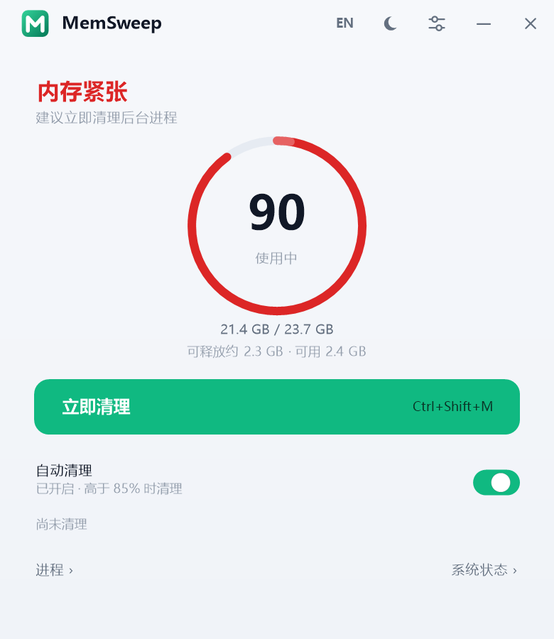
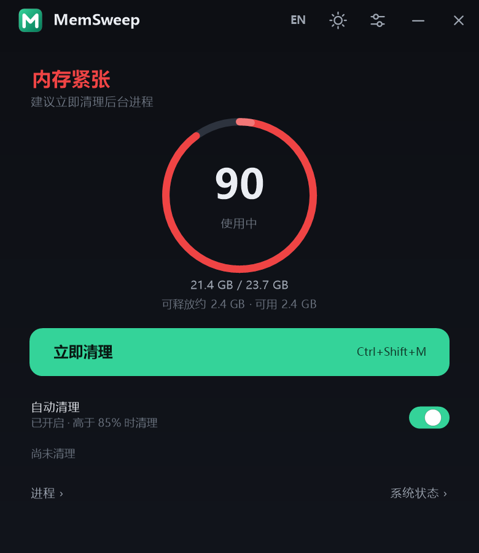
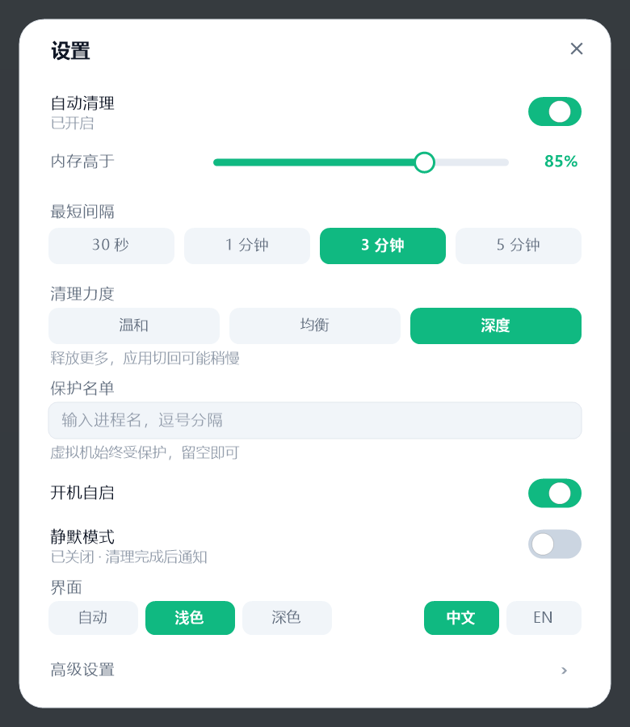
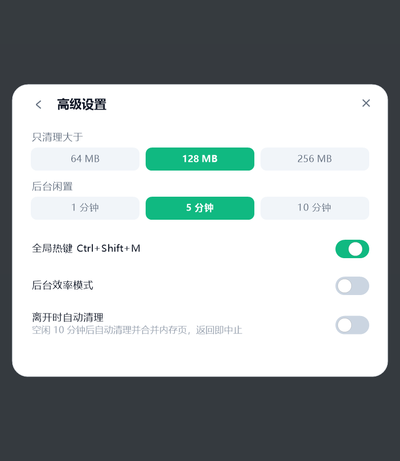
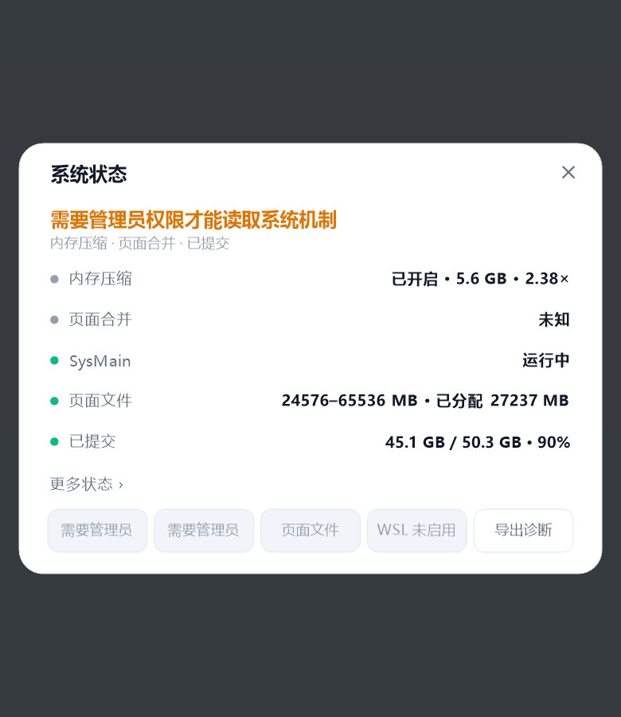

# 内存速清 MemSweep

[](https://github.com/feiyu-labs/MemSweep/actions/workflows/ci.yml)
[](https://github.com/feiyu-labs/MemSweep/releases/latest)
[](LICENSE)

> 单文件 ~392KB · 主屏约 9.5MB / 托盘约 3–6MB（专用工作集） · 零依赖 · 无网络无遥测 · 前台免疫 · UI 永不阻塞的 Windows 智能内存守护

MemSweep 是为「重度开发机内存常年 90%+」场景设计的现代内存清理器。它把 2026 年全网内存清理方案
（Mem Reduct / WinMemoryCleaner / Process Lasso SmartTrim / ISLC / RAMKeeper / WinMemClean 等）
的精华合成为一套**分层智能引擎**，并修掉了同类工具导致卡死、误伤前台、反复抖动、刷盘伤 SSD 的所有已知坑。

| 浅色主题 | 深色主题 |
|---|---|
|  |  |

## 📦 获取

- **下载**：[GitHub Releases](https://github.com/feiyu-labs/MemSweep/releases/latest)
  （`MemSweep-<版本>-x64.zip` / `-arm64.zip`，内含 `MemSweep.exe`、`install.cmd`、
  `uninstall.cmd`、`INSTALL.txt`、`LICENSE`，各附 SHA256）
- **安装**：解压后右键 `install.cmd` 以管理员运行（复制到 Program Files +
  计划任务开机自启 + 桌面快捷方式）；卸载运行 `uninstall.cmd`，配置与日志保留在
  `%APPDATA%\MemSweep\`
- **Windows on ARM**：原生 ARM64 构建随 Release 提供
- **代码签名**：筹备中，见 [CODE_SIGNING.md](CODE_SIGNING.md)（未签名版本请核对 Release 内 SHA256）

---

## ✨ 核心特性

### 智能引擎（同赛道独有组合）

1. **正确触发语义** — `已用 ≥ 阈值` + 清理间隔 + **真实枯竭**（可用 < 512MB 或使用率 ≥ 95%）
   - `free` 低是 Windows 正常使用待机缓存的结果，不再单独当作“快没内存”
   - 修复 WinMemoryCleaner「可用 < 82%」导致死循环卡死的设计
2. **前台免疫** — 焦点窗口 + 其父进程链 + 最近 120 秒焦点历史 + 系统关键进程，**一页不碰**
3. **空闲感知** — 常规压力只修剪「后台 + CPU 低活动 ≥ 300 秒 + 工作集 ≥ 128MB」的进程
   （Process Lasso SmartTrim 思想，免费实现）；真实枯竭时才允许非空闲后台修剪
4. **分层执行 + 防抖**
   - 自动模式：空闲后台修剪 + 低优先级缓存可同次执行；真实枯竭才升级为「非空闲修剪 + 全量缓存」；
     **自动模式永不合并页面**
   - 手动模式：全量缓存 → 系统文件缓存 → 工作集修剪；可选「深度清理」合并重复物理页（默认关）
   - 同一进程 10 分钟内不重复修剪（除非工作集增长 > 1.5 倍）
5. **效果统计修正（v1.7）** — 同时记录「空闲增量」和「可用增量」；主屏/气泡优先显示空闲增益，
   不再出现缓存已清空、空闲已恢复 300MB，界面却写“释放 0MB”的误导
6. **并发加固（v1.8）** — 快照缓冲 thread_local、配置不可变快照、保护名单锁内原子交换、
   共享计数原子化；特权按需开启/用后关闭
7. **离开时深度维护（v1.8，默认关）** — 会话空闲 ≥10 分钟且内存偏高时，后台修剪空闲后台 +
   低优先级缓存 + 页面合并；用户一有输入立即中止；6 小时冷却

### 永不做的危险操作

| 操作 | 为什么不做 |
|---|---|
| ❌ 脏页强刷盘（MemoryFlushModifiedList） | 全网卡死事故的元凶；SSD 写入风暴 |
| ❌ 注册表缓存刷盘 | 纯写盘、无内存收益 |
| ❌ 全局 `MemoryEmptyWorkingSets` 一刀切 | 会连前台一起冻结 |
| ❌ 定时器分辨率 hack | 游戏向副作用，破坏系统电源管理 |
| ❌ 结束/挂起进程 | 越界，不属于内存清理 |

### One Screen（v1.6 重构，v1.7 打磨）

- **520×600 单窗口**：没有顶部三页导航，没有设置子页；右上角设置按钮打开一层 Sheet
- **品牌标记**：标题栏 M 标记与 `res/icon.ico` 共用同一套 256 网格几何；ico 含 16/20/24/32/48/256 六个关键尺寸，其余由 Windows 缩放
- **主屏只有 4 组**：状态句、仪表盘、主操作、两个低权重文字入口
  - `内存充足 / 内存偏高 / 内存紧张` 代替“当前内存”技术标题
  - 细环 + 百分比 + 沿弧滑过的高光（7s 一圈，静止也有生命感）；
    指标行“可释放约 X · 可用 Y”——点清理前就有预期
  - 唯一主按钮「立即清理」；自动清理一行 + 开关；上次清理一行显示空闲增益
  - “进程 ›”与“系统状态 ›”按需打开 Sheet
- **设置是一张单列 Sheet**：自动清理 / 阈值 / 间隔 / 力度 / 保护名单（输入或「选择应用」）/
  自启 / **静默**；修改即时保存。主题与语言**只在标题栏快切**（日/月图标 + 中/EN 胶囊），设置页不重复
- **高级**默认折叠 5 项：只清理大于 / 后台闲置 / 全局热键 / 后台效率模式 / 离开时自动清理；
  抖动保护内置为安全护栏不暴露开关，页面合并跟随「清理力度 = 深度」，静默模式在设置页
- **进程 / 系统状态**各自是紧凑 Sheet，按内容缩短高度，不再用大面积空白撑满窗口
- Sheet 200ms ease-out + 缓动曲线；**环境动效 6.7fps 仅可见主屏**（实测可见 3.1% /
  隐藏 1.6% 单核预算），没有任何常驻 60fps



### 关于（v1.9.11）

设置页底部「关于 MemSweep」或托盘右键 →「关于 MemSweep…」打开：

- 品牌标记 + 版本/架构（`v1.9.11 · x64`）
- GitHub 仓库 / 问题反馈 / 检查更新（用系统浏览器打开，应用自身不联网）
- `MIT License · 不联网 · 不收集数据 · © 2026 feiyu-labs`


高级设置（固定 5 项，默认折叠）：



### 稳定性与流畅度（v1.4 起）

- **UI 线程零阻塞**：`Get-MMAgent` / WMI / `schtasks` 全部移到工作线程；
  主窗口消息 Ping **0ms**。
- **Sheet 不拖帧**：200ms 时间基准过渡，只在打开期间启动 16ms 定时器，结束立即 kill。
- **文字不闪**：`AntiAliasGridFit` + 双缓冲 + `WS_CLIPCHILDREN`，150% 分数缩放无彩边/抖动。
- **全部窗口禁用 IME/TSF**：避免 Chatterfly 输入法注入约 56MB。
- **系统机制自修复**：一键启用压缩/页面合并时，会先把 SysMain 设为自动并启动。

### 系统状态 Sheet（v1.6，v1.7 文案修正）

主屏底部「系统状态 ›」按需打开，不再占一个顶层页：

- 先给一句健康摘要，再列压缩 / 页面合并 / SysMain / 页面文件 / 提交
- “更多状态”展开预取、快速启动、内核池、WSL
- 只有需要修复时才出现主操作按钮；导出诊断留在底部
- 异步读取，不阻塞主屏



### 进程 Sheet（v1.9.8 合并保护名单）

主屏「进程 ›」或设置页「保护名单 → 选择应用 ›」打开同一张表：

- 全部进程按专用工作集排序，滚轮浏览（一次 8 行，右侧滚动条）
- 表头 **应用 / 内存 / 保护**；副标题直接说明结果：勾选后清理时跳过、不释放其内存
- **点击行 = 切换保护**（绿勾 = 清理时跳过）；**右键 = 释放此进程内存**
- 系统进程与虚拟机显示锁标记，始终保护、不可切换
- 保护名单是**精确进程名匹配**：不区分大小写，`chrome` 与 `chrome.exe` 等价；
  多个用逗号 / 分号分隔（不是关键字或模糊匹配）
- 设置页仍保留输入框，给“未安装/未运行的应用”或批量粘贴用


### 离开时深度维护（v1.8，默认关）

- 高级设置开关；触发条件：会话空闲 ≥ 10 分钟（`idleDeepSecs` 可调）且
  使用率 ≥ 阈值或提交 ≥ 85%，非低电量、非全屏/演示
- 后台动作：空闲后台工作集修剪 + 低优先级缓存 + 页面合并；**不清全量缓存/文件缓存**
- 用户一有输入立即中止（`GetLastInputInfo` watcher → `MEMORY_COMBINE_INFORMATION_EX.EventHandle`）
- 6 小时冷却（`idleDeepCooldownSec`）；实测空闲 5 秒测试配置下
  合并 280,733 页 ≈1.1GB，空闲 +963MB / 可用 +751MB / 14.9s

### 深度清理（跟随清理力度）

- 托盘右键 →「深度清理（合并内存页）…」、`MemSweep.exe /combine`，或使用「清理力度 = 深度」
- 调用内核页面合并（`SystemCombinePhysicalMemoryInformation`），去重相同物理页
- 实测：一次合并 **155,320 页 ≈607MB**；另一次 **143,453 页 ≈560MB**；可用/空闲再增加数百 MB
- **可能耗时 10–60 秒**（本机最慢一次 52.6s），会短暂占用 CPU；因此只挂在「深度」力度与
  显式托盘动作上，**自动模式永不合并**。主屏会显示「正在合并内存页」，UI 不冻结

### 精准进程操作（v1.3，v1.9.8 合并入口）

- **进程表右键**：`释放此进程内存`（保护中/系统进程置灰）
- **进程表左键**：切换保护，与设置页名单双向同步
- CLI：`MemSweep.exe /trimpid <PID>` 精准修剪单个进程

### 交互

| 入口 | 功能 |
|---|---|
| 左键托盘 | 打开面板 |
| 右键托盘 | 菜单（立即清理 / 自动清理 / 开机自启 / 日志 / 退出） |
| 中键托盘 | 秒清 |
| `Ctrl + Shift + M` | 全局热键立即清理（可关） |
| `MemSweep.exe /clean` | 命令行单次清理（可进自动化） |
| `MemSweep.exe /dryrun` | 演练模式：只报告将清理什么，不动手 |
| `MemSweep.exe /selftest` | 策略引擎自检（CI 可用） |
| 托盘右键 → 深度清理 | 合并重复内存页（10–60s，需确认；仅深度力度/显式动作） |
| 进程表左键 / 右键 | 切换保护 / 释放此进程内存 |
| `MemSweep.exe /combine` | 深度清理（10–60s；已运行实例则转发） |
| `MemSweep.exe /trimpid <PID>` | 精准修剪单个进程 |
| `MemSweep.exe /pause` | 暂停自动清理 1 小时（已运行实例则转发） |
| `MemSweep.exe /resume` | 恢复自动清理 |
| `MemSweep.exe /exit` | 退出正在运行的实例 |

### 启动与窗口行为（v1.1 打磨）

- **双击 exe / 桌面快捷方式** → 直接显示面板（不再静默进托盘）
- **开机计划任务**（带 `/tray`）→ 静默托盘启动
- **左键托盘** → 始终打开面板（不再"显示/隐藏"切换；双击不会闪退）
- **关闭按钮** → 最小化到托盘；托盘右键 → 退出
- 窗口为 **无边框自绘**（无原生标题栏），Win11 DWM 圆角 + 阴影
- 若面板被全屏游戏遮挡，会弹托盘气泡提示 `Alt+Tab`
- **键盘**：`Esc` 关闭 Sheet / 隐藏、`Ctrl+Enter` 立即清理、`Ctrl+S` 立即保存当前设置
- **内存**（任务管理器「专用工作集」口径）：主屏 **约 9.5MB**（工作集 17MB，含 2.8MB 双缓冲），托盘稳定后 **约 3MB**（私有提交约 9.6MB；隐藏即释放双缓冲 + HeapCompact，空闲后系统回收工作集）；特权按需开启；全部窗口禁用 IME 注入

---

## 📦 安装 / 卸载

### 安装（管理员）

```cmd
build.cmd            :: 先构建（见下文）
install.cmd          :: 右键 → 以管理员身份运行
```

安装脚本会：
1. 复制到 `C:\Program Files\MemSweep\`
2. 创建计划任务 `MemSweep`（`ONLOGON` + `/RL HIGHEST`，开机无 UAC 弹窗）
3. 启动并常驻托盘

### 卸载

```cmd
uninstall.cmd        :: 右键 → 以管理员身份运行
```

配置与日志保留在 `%APPDATA%\MemSweep\`（如需彻底清除请手动删除）。

> WinMemoryCleaner 已从本机彻底移除，不再提供回滚项。

---

## ⚙️ 默认参数（针对 24GB 重度开发机调校）

| 参数 | 默认值 | 说明 |
|---|---|---|
| 占用达到 | **85%** | 已用内存占比（与任务管理器一致） |
| 清理间隔 | **180s** | 两次自动清理最小间隔 |
| 空闲阈值 | **300s** | 进程 CPU 零增量多久算「空闲」 |
| 最小修剪 | **128MB** | 自动模式只碰大工作集 |
| 空闲地板 | **1500MB** | 真正空闲低于此值才考虑清缓存 |
| 缓存地板 | **1024MB** | 待机缓存低于此值不清（收益太小） |
| 焦点保护 | **120s** | 最近获得过焦点的进程都保护 |
| 保护名单 | `qemu-system-i386, vmmemwsl`（VM 也内置硬保护） | 开发工具交给前台/焦点/空闲判断 |

全部参数可在面板调整或直接编辑 `%APPDATA%\MemSweep\config.ini`。

### 保护名单/修剪策略

- **VM 永远硬保护**：`qemu-system-i386` / `qemu-system-x86_64` / `vmmemwsl` 内置在保护名单中。
  修剪客户机热页会造成 guest 大范围缺页，收益远小于代价。
- **开发工具不再默认硬保护**：`claude / zcode / hermes` 由“前台 + 父链 + 最近 120 秒焦点历史”
  自动保护；只有后台且空闲达到阈值（默认 300 秒）才会进入自动修剪。
- **手动“立即清理”**可以修剪后台开发工具，所以你会感觉更有效；它仍不会碰前台/焦点历史。
- 保护名单建议只放必须常驻的后台；清空也可以，但 VM 的内置保护仍在。
- 需要知道：`EmptyWorkingSet` 把页移到待机/页面文件，**提交量不会下降**；切回应用时可能重新缺页。
  因此 MemSweep 不做全局 `EmptyWorkingSets`、不刷脏页，也不在自动模式全区清空。


---

## 🧠 设计边界（诚实说明）

1. **清理器不能降低提交（Commit）**。提交 58GB 压在 24GB 物理内存上时，任何软件都只能搬运字节；
   真正降提交要靠关闭程序、调整 `-Xmx/--max-old-space-size` 或进程级 Commit 上限。
2. **「使用中」百分比**在任务管理器里 = 已用物理页。修剪工作集能让它下降；清待机只把
   「待机」变成「空闲」，不改变「可用%」（Windows 定义：可用 = 空闲 + 待机）。
   因此 MemSweep 的自动模式**以工作集修剪为主**。
3. **Windows 11 26H2 起系统内存管理已大幅改进**（微软官方数据：多保留 2GB 活跃数据、
   提交增长减少 900MB）。MemSweep 的定位是「补 OS 之不能」——治理失控的 Electron/V8/IDE 进程，
   而不是对抗系统。
4. 本工具不联网、不收集数据、不自动更新。

---

## 🧭 技术栈结论（2026-11 调研）

- **Tauri 2.12**：安装包确实小（1–15MB），但 Windows 上仍跑 WebView2/Chromium；
  2026-10 实测 Tauri 空窗 **142MB private / 333MB WS**，托盘应用甚至可能留下
  **113MB private / 310MB WS** 的 WebView2 助手进程。对“内存清理器”而言这是自相矛盾。
- **Slint / egui**：原生 Rust UI，但常驻约 **30–95MB / 100–185MB**，且需要重写现有 C++ 引擎。
  仅在未来要跨平台时才值得评估 Slint。
- **WinUI 3**：复杂应用实测 WS 约 155MB，还要 Windows App SDK；不符合轻量托盘工具。
- **C++/Win32 + GDI+（当前）**：**约 9.5MB 专用工作集 / 17MB WS**（主屏）；托盘稳定后约 3MB（私有提交 9.6MB），零额外运行时。
  520×600 窗口下 GDI+ 足够；若未来过渡帧率不够，再加 Direct2D/DirectWrite + DirectComposition，
  仍然不引入 WebView。

“先进”不等于“流行”；对这个产品，先进是**更少常驻内存、更快启动、更少运行时**。
调研来源与数据见 [RESEARCH.md](RESEARCH.md)。

## 📊 本机实测（24GB / i7-12800HX / Win11 26H2 26340）

| 场景 | 结果 |
|---|---|
| **v1.7 单次快速清理（提权）** | 候选 117，修剪 116，全量缓存 + 文件缓存，**空闲 +3509MB，可用 +1128MB，4.14s** |
| **v1.7 自动低优先级缓存** | 缓存 2.3GB；**空闲 3.3→4.2GB（+991MB）**，可用 5.5→5.5GB，0.34s |
| **v1.7 深度清理（可选）** | 合并 155,320 页 ≈607MB，空闲 +1635MB，可用 +1112MB，总 9.94s；另一次 143,453 页/560MB/7.2s |
| **v1.7 深度整理最慢样本** | 合并 284,040 页 ≈1.1GB，可用 1.8→5.8GB，但耗时 **52.6s** → 仅在「清理力度=深度」或托盘显式动作时执行 |
| **v1.8 页面合并（EventHandle）** | 合并 221,659 页 ≈866MB，空闲 20MB→1.2GB，18.1s；超时/取消可中止 |
| **v1.8 离开时维护实测** | 空闲 5 秒测试配置：合并 280,733 页 ≈1.1GB，**空闲 +963MB，可用 +751MB，14.9s** |
| **v1.9.2 CPU 预算** | 主屏可见 **1.6%**（托盘图标按百分比重建节流后）；隐藏态 1.6~4.7% 波动来自整机负载与 5s 采样守护（tick 实测 0.32%）；环境高光 6.7fps |
| **v1.9 可释放估算** | 主屏直接显示“可释放约 X”（空闲候选专用WS + 缓存，随清理力度） |
| **v1.9 自身内存** | 托盘 **5.9MB 私有 / 5.4MB WS** |
| **v1.8 自身内存（历史）** | 主屏 8.2MB 私有 / 12.7MB WS；托盘隐藏 6.5MB / 11.1MB WS；全新托盘启动 5.9MB / 5.2MB WS |
| v1.7 自身内存（历史） | 主屏 9.7MB 私有 / 14.2MB WS；托盘隐藏 6.9MB / 11.5MB WS；隐藏即释放双缓冲 |
| v1.6 历史 | 主屏 9.9MB 私有 / 15.4MB WS；设置 9.7MB；托盘 5.9MB（20s 后释放） |
| v1.4 历史 | 面板 11.4MB / 系统检查窗口 15.4MB；未禁用 IME 时 71.8MB |
| 保护验证 | 前台/焦点历史/qemu/系统关键进程工作集**完全不变**；VM 内置硬保护 |
| 自动触发 | 84–91% 负载正确触发；`free` 低但可用充足时不再误触发 |

### 当前部署状态（2026-11-15）

- 安装位置：`C:\Program Files\MemSweep\MemSweep.exe`（**v1.9.11.0**，401,920 字节）
- SHA256：`FE2441AD3F7D86E99FC49FA153A3655A365CBD20B7CFA46FD29F10FBEB484FA3`
- 计划任务：`MemSweep`（登录触发 / HighestAvailable / 电池供电可启动 / 无限执行时限）
- `WinMemoryCleaner`：**已彻底移除**（进程/任务/winget 包/ARP/注册表/快捷方式/残留目录）
- 主题：浅色（面板底部 自动/浅色/深色，已验证点击生效）
- 窗口：无边框 **520×600 逻辑**，PerMonitorV2 支持 100–250%；当前显示 100%，文档截图按 150% 渲染
- 启动：手动=显示面板；计划任务 `/tray`=静默托盘；桌面快捷方式已创建
- **页面文件：D: 24576–65536 MB 已生效（allocated 31095MB；回滚 16384/49152）**
- **SysMain：Running / Automatic**；页面合并、内存压缩均开启
- 内存压缩存储约 5.1GB · 2.55×；非分页池约 1.1GB；预取/预启动仍关闭（系统原有设置）
- 「离开时自动清理」默认关闭（`idleDeep=0`）；力度=深度（含合并页）；保护名单为空，VM 由内置保护兜底

---

## 🏗 技术架构

```
src/common.h   基础类型 / 配置 / 日志 / 格式化
src/core.h/.cpp  NT 快照 / 指标 / 策略 / 清理引擎 / 自检
src/ui.h/.cpp   GDI+ 自绘 UI / 托盘 / 热键 / 主题 / 动画
src/main.cpp    入口 / CLI / 单实例转发
res/            图标 + UAC 清单 + 版本信息
```

**关键 API（数值已对照 phnt / SystemInformer 头文件与微软文档核验）**

| API | 用途 | 权限 |
|---|---|---|
| `NtSetSystemInformation(80, MemoryPurgeStandbyList=4)` | 全量清待机 | SeProfileSingleProcess |
| `NtSetSystemInformation(80, MemoryPurgeLowPriorityStandbyList=5)` | 温和清待机 | 同上 |
| `NtSetSystemInformation(81, FILECACHE{-1,-1})` | 修剪系统文件缓存 | SeIncreaseQuota |
| `NtQuerySystemInformation(5)` | 零句柄进程快照（WS/Commit/CPU/硬缺页） | 无 |
| `NtQuerySystemInformation(80)` | 空闲/待机/修改页分优先级统计 | 无 |
| `EmptyWorkingSet` | 单进程工作集修剪 | PROCESS_SET_QUOTA |
| `SetProcessInformation(ProcessPowerThrottling)` | EcoQoS（进阶，默认关） | PROCESS_SET_INFORMATION |
| `SetProcessInformation(ProcessMemoryPriority)` | 内存优先级 LOW（进阶，默认关） | 同上 |

---

## 🔨 构建

需要 [zig](https://ziglang.org/) 0.17.1：放到仓库同级 `../tools/` 目录，或设
`ZIG` 环境变量指向 zig.exe（CI 即用此方式自动下载）。也可直接用 CI 产物。

```cmd
build.cmd          :: 正式版（requireAdministrator）
build.cmd dev      :: 开发版（asInvoker，可免提权跑 UI 与 /clean）
build.cmd test     :: dev + /selftest + /idlecheck + /uipng + /checkpng（CI 可用）
build.cmd arm64    :: Windows on ARM 交叉编译
```

产物：`dist\MemSweep.exe`（~359KB，静态链接，无 CRT/DLL 依赖）。

---

## 🧪 工程与质量（v1.7）

- 编译告警：`-Wall -Wextra -Wshadow -Wformat=2 -Wundef -Wpointer-arith -Werror`，**零警告**
- `build.cmd test` 一键回归（策略自检 / 空闲诊断 / 双界面快照）
- 工程规范：[docs/ENGINEERING.md](docs/ENGINEERING.md) · [CHANGELOG.md](CHANGELOG.md) · `.editorconfig` · `.clang-format`
- 崩溃记录：`SetUnhandledExceptionFilter` 写入 `CRASH exception=...`
- 线程纪律：UI 线程不做 PowerShell/WMI/schtasks；`SysState` 本地快照 + `SRWLOCK` 换入
- 内存治理：托盘图标节流、隐藏释放双缓冲、GDI+ 字体缓存、全部窗口禁用 IME 注入
- 体积：**392KB** 单文件（401,920 字节，静态链接、零运行时依赖）

## ❓ FAQ

**Q：按了清理，任务管理器百分比为什么有时不降？**
A：百分比看的是「使用中」。若没有可修剪的空闲后台进程（都被前台保护/近期活跃），
自然不降；此时清理仍会把缓存转为空闲，降低分配延迟。**提交内存也无法通过清理降低**；
面板/系统 Sheet 会明确提示。上次清理优先显示「空闲 +X」，它才是真正立刻可分配的页。

**Q：会不会像 WinMemoryCleaner 那样卡死？**
A：不会因系统查询卡死。v1.4 把 `Get-MMAgent` / WMI / `Get-WindowsOptionalFeature` / `schtasks`
全部移到工作线程，UI 线程只做轻量读取；系统页异步回填，页面切换不阻塞。
普通清理仍有 2/6 秒预算；只有手动开启「深度整理」时才会额外合并页面（10–60s，可关闭）。

**Q：为什么必须管理员？**
A：清理系统缓存与系统文件缓存是内核特权操作（`SeProfileSingleProcessPrivilege`）。
计划任务以最高权限启动，日常无 UAC 弹窗。

**Q：双击 exe 只闪一下、没有界面？**
A：v1.1 已修复三个根因：① 托盘左键此前是"显示/隐藏"切换，双击会显示后立即隐藏；② 手动启动也带了 `/tray` 语义，静默进托盘；③ 窗口有原生边框导致双标题栏/内容挤压。现在手动启动必定显示面板，托盘左键永远打开，被全屏游戏遮挡时会有气泡提示。

**Q：任务管理器里 MemSweep 内存为什么有时 11MB、有时 5MB？**
A：主屏双缓冲约 1.2MB（150% 时约 2.8MB），实测私有 **8.2MB**（轮询 Sheet 后）、全新托盘 **5.9MB**；隐藏/最小化立即释放双缓冲。
隐藏/最小化会**立即**释放双缓冲，托盘私有约 **6.9MB**；重新显示时按需重建。Sheet 只做 200ms 位移，不额外保留页面位图。
全部窗口禁用 IME/TSF，否则 Chatterfly 输入法会注入约 56MB。

**Q：自动清理为什么现在更“克制”？**
A：v1.7 不再把 `free` 低当成内存枯竭。Windows 会把空闲 RAM 用作待机缓存，`free` 常年几百 MB 很正常；
只有「可用 < 512MB」或「使用率 ≥ 95%」才算真实压力。常规高压下自动模式仍会修剪空闲后台并清低优先级缓存；
真实枯竭才升级为非空闲后台修剪 + 全量缓存，且不会每 3 分钟重复全量清空。

**Q：离开时深度维护会在我用电脑时突然卡一下吗？**
A：不会。它只在会话空闲 ≥10 分钟（无键盘/鼠标输入）且内存偏高时启动；只要你一有输入，
watcher 立刻通过内核 EventHandle 中止页面合并、停止修剪。它也不清全量缓存/文件缓存，
所以回到电脑前台不会遇到“缓存被清空后第一次操作变慢”。默认关闭，6 小时冷却。

**Q：深度清理（合并内存页）为什么只在“深度”力度？**
A：它请求内核扫描并合并重复物理页，效果真实（本机单次 560–1100MB），但实测耗时 7–52 秒，
期间会占用 CPU。为不把“点一下清理”变成一分钟等待，它只挂在「清理力度 = 深度」和
托盘「深度清理」单独动作（带确认）上；常规力度永远不触发。

**Q：杀毒软件误报？**
A：无网络、无注入、无驱动。如遇误报请核对 SHA256 或自行编译。

---

## 📄 License

[MIT](LICENSE) © feiyu-labs。第三方文档/思路引用见 [RESEARCH.md](RESEARCH.md)。
欢迎 Issue / PR，见 [CONTRIBUTING.md](CONTRIBUTING.md)。
