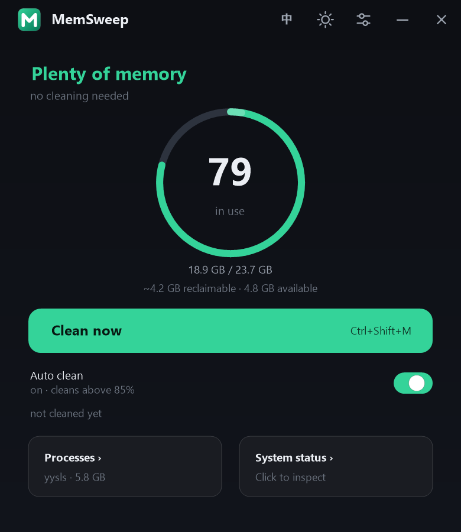
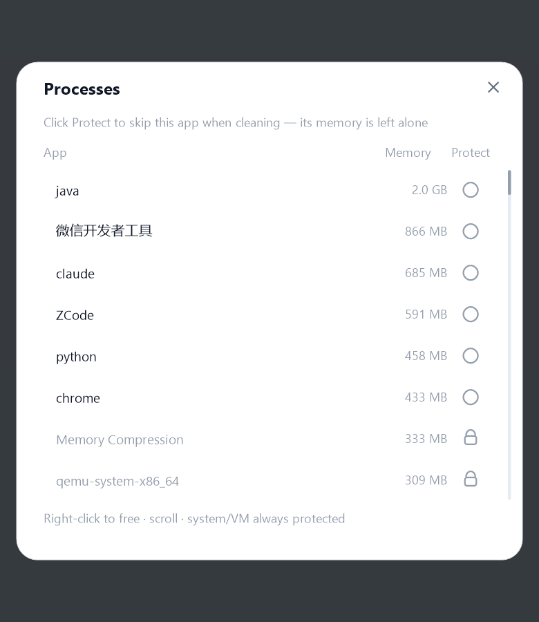
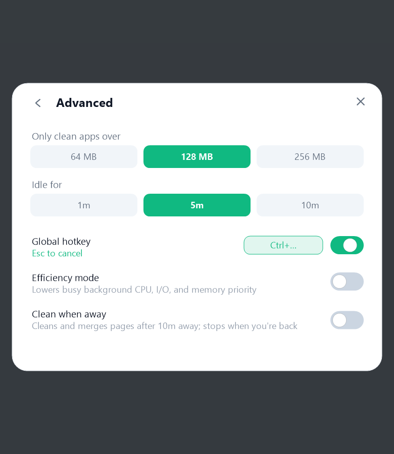

# MemSweep

<p align="center">
  <a href="README.md"><b>English</b></a> · <a href="README.zh-CN.md">简体中文</a>
</p>

<p align="center">
  
</p>

<p align="center">
  <strong>Windows memory cleaner. It reclaims memory from idle background processes and leaves what you're using alone.</strong>
</p>

<p align="center">
  <a href="https://github.com/feiyu-labs/MemSweep/releases/latest"><b>Download for Windows</b></a><br>
  Windows 10 and 11 · x64 and ARM64 · 398 KB
</p>

<p align="center">
  <a href="https://github.com/feiyu-labs/MemSweep/actions/workflows/ci.yml"></a>
  <a href="https://github.com/feiyu-labs/MemSweep/releases/latest"></a>
  <a href="LICENSE"></a>
  
  
  
  
</p>

<p align="center">
  <a href="#install">Install</a> ·
  <a href="#features">Features</a> ·
  <a href="#compared-with">Compared with</a> ·
  <a href="#command-line">Command line</a> ·
  <a href="#footprint">Footprint</a> ·
  <a href="#faq">FAQ</a> ·
  <a href="#privacy">Privacy</a> ·
  <a href="#build-from-source">Build</a> ·
  <a href="#roadmap">Roadmap</a> ·
  <a href="CHANGELOG.md">Changelog</a>
</p>

<table align="center">
  <tr>
    <th align="center">Light</th>
    <th align="center">Dark</th>
  </tr>
  <tr>
    <td></td>
    <td></td>
  </tr>
</table>

## What it is

MemSweep reclaims memory held by idle background processes, so the apps you're using stay responsive. It's a single 398 KB executable with no drivers, background services, or network code.

Instead of flushing modified pages or sweeping every process on a fixed timer, it waits until memory is tight, trims only idle background apps, and logs what it freed.

| | |
|:---|:---|
| **Platform** | Windows 10 and 11, native x64 and ARM64 builds |
| **Size** | 398 KB binary, no runtime dependencies |
| **Memory** | 9.5 MB open · 3.0 MB in the tray |
| **Requirements** | Administrator rights for cleaning; the installer registers a logon task, so daily use never prompts |
| **License** | MIT |

## Features

- **Automatic cleaning only touches idle background apps.** The app you're using, the processes that launched it, and anything you touched in the last two minutes stay untouched. Background apps qualify after five minutes of near-zero CPU (adjustable in Settings). When memory compression is high, MemSweep spaces out repeat trims so apps don't bounce right back.
- **It clears real bottlenecks instead of spinning on 0 MB.** A pass starts when in-use memory passes your threshold (85% by default) or memory gets low. When free pages stay starved even though gigabytes sit in higher-priority standby cache, automatic passes can clear the full standby list once every ten minutes when paging is calm.
- **Efficiency mode lowers busy background CPU, disk I/O, and memory priority.** When turned on in Advanced settings, busy non-foreground processes temporarily yield CPU and I/O priority while you work, and return to normal the moment they settle or you switch back to them.
- **Processes are grouped by app.** Chrome, Electron, and IDE windows roll up into one total per app, so you can see who's holding memory, protect the whole app in one click, or right-click to free all its background instances at once.
- **It won't run operations that freeze Windows.** No modified-page flush, no registry-cache flush, no global working-set sweep, no timer changes, and no killing processes.
- **Duplicate pages can be merged.** Identical physical pages become one copy; it runs manually in Deep cleanup or while you're away and stops the moment you press a key.
- **It checks what Windows is doing.** System status reports compression, page combining, SysMain, the page file, commit charge, kernel memory, and WSL memory reclaim, and exports diagnostics.
- **It stays quiet and light.** No notifications during fullscreen games, presentations, or Focus Assist; one 398 KB file, about 3 MB in the tray, light and dark themes, English and Chinese, and a customizable hotkey (Ctrl+Shift+M by default).

<table align="center">
  <tr>
    <td align="center"><b>Settings</b></td>
    <td align="center"><b>Processes and protection</b></td>
  </tr>
  <tr>
    <td></td>
    <td></td>
  </tr>
  <tr>
    <td align="center"><b>System status</b></td>
    <td align="center"><b>Set the hotkey</b></td>
  </tr>
  <tr>
    <td></td>
    <td></td>
  </tr>
</table>

## Install

Download `MemSweep-v2.0.2-x64.zip` or `MemSweep-v2.0.2-arm64.zip` from [Releases](https://github.com/feiyu-labs/MemSweep/releases/latest), extract it, then right-click `install.cmd` and choose **Run as administrator**.

The script copies `MemSweep.exe` to `C:\Program Files\MemSweep\`, registers an elevated logon task so startup never prompts, adds a desktop shortcut, and starts MemSweep in the tray.

To remove it, right-click `uninstall.cmd` and choose **Run as administrator**. Settings and logs stay in `%APPDATA%\MemSweep\`.

To keep settings and logs beside the program, put an empty file named `MemSweep.ini` in the same folder as `MemSweep.exe` before the first launch.

## Command line

```cmd
MemSweep.exe /clean          :: clean once, then exit
MemSweep.exe /dryrun         :: report what would be cleaned; change nothing
MemSweep.exe /combine        :: merge duplicate physical pages
MemSweep.exe /trimpid <PID>  :: trim one process
MemSweep.exe /pause          :: pause automatic cleaning for one hour
MemSweep.exe /resume         :: resume automatic cleaning
MemSweep.exe /tray           :: start in the tray (used by the logon task)
MemSweep.exe /show           :: open the window, or forward to the running instance
MemSweep.exe /selftest       :: run the policy engine self-test; exit code 0 on pass
MemSweep.exe /exit           :: shut down the running instance
```

## Footprint

Measured on Windows 11 26H2 (26340), i7-12800HX, 24 GB RAM, 150% scaling. Figures are the private working set Task Manager reports.

| State | Private working set | Private commit |
|:---|:---:|:---:|
| Window open | 9.5 MB | 12.2 MB |
| Minimized to tray | 6.0 MB | 9.2 MB |
| Tray, settled | **3.0 MB** | 9.6 MB |

A manual clean on this machine reclaims 1–3 GB of free pages depending on what's running.

## Compared with

| | MemSweep | Mem Reduct | WinMemoryCleaner | Process Lasso (SmartTrim) | ISLC |
|:---|:---:|:---:|:---:|:---:|:---:|
| Binary size | 398 KB | ~373 KB (installer) | ~471 KB + .NET | ~3.6 MB installer, ~80 MB suite | ~1.5 MB |
| Tray memory | 3.0 MB | Not published | Not published | Not published | ~27 MB (measured by MakeUseOf) |
| Foreground immunity | Window, parent chain, 120 s focus history | No | No | Exclusion list | No |
| Trigger checks real pressure | Yes | No | No | Partial | Partial |
| Modified-page flush | Never | Optional | Yes | No | No |
| Page combining | Yes, abortable | No | No | No | No |
| Clean record | Text log + diagnostics export | Text log | JSON event log | Yes | No |
| Native ARM64 | Yes | Yes | No | Yes | No |
| Automatic mode omits freeze-prone lists | Yes | Optional | No | Optional | No |

Versions checked as of November 2026: Mem Reduct 3.5.2, WinMemoryCleaner 3.0.8, Process Lasso 19.0, and ISLC 1.0.4.8. Rows reflect published defaults and documented behavior; check each tool's docs for newer releases. User-reported freezes in this category (Mem Reduct issues #17/#90, WinMemoryCleaner issue #192, ISLC forum threads) shaped MemSweep's trigger and notification rules.

## Build from source

MemSweep builds with [Zig](https://ziglang.org/) as the C++ toolchain, so no Visual Studio installation is required.

```cmd
git clone https://github.com/feiyu-labs/MemSweep.git
cd MemSweep

build.cmd          :: release build (dist\MemSweep.exe)
build.cmd test     :: dev build, self-test, idle check, headless UI renders
build.cmd arm64    :: Windows on ARM64
```

The pinned compiler is zig 0.17.1: place it in `../tools/` next to the repository, or point `ZIG` at `zig.exe`. Warnings are errors, and CI runs `build.cmd test`.

## FAQ

**The percentage didn't drop after cleaning.**
That number counts in-use physical pages. When background processes are busy or protected, MemSweep reclaims standby cache instead, which speeds up the next allocation rather than moving the percentage.

**Can it lower committed memory?**
No. Commit charge is memory Windows promised to applications; trimming moves pages between RAM, standby, and the page file. Close applications or lower heap limits (`-Xmx`, `--max-old-space-size`) to reduce it.

**Why does it need administrator rights?**
Purging standby lists and trimming the file cache require system privileges. The installer registers an elevated logon task, so daily use never prompts.

## Privacy

MemSweep has no network code: no telemetry, no update checks, and nothing leaves your machine. Outbound links in the About page only open your browser when you click them. Settings and logs stay in `%APPDATA%\MemSweep\`.

## Community

Bug reports and pull requests are welcome—see [CONTRIBUTING.md](CONTRIBUTING.md). Report security issues privately as described in [SECURITY.md](SECURITY.md). Architecture notes live in [docs/ENGINEERING.md](docs/ENGINEERING.md), and threshold research in [RESEARCH.md](RESEARCH.md).

## Roadmap

1. **Signed releases and winget updates** — code-signed binaries and `winget upgrade feiyu-labs.MemSweep` once the community package review lands.
2. **Per-app memory profiles** — custom protection presets for browsers, IDEs, and local AI tools.

Not planned: process termination, RAM "defragmentation", timer-resolution tweaks, or network features.

## License

[MIT](LICENSE) © feiyu-labs.
