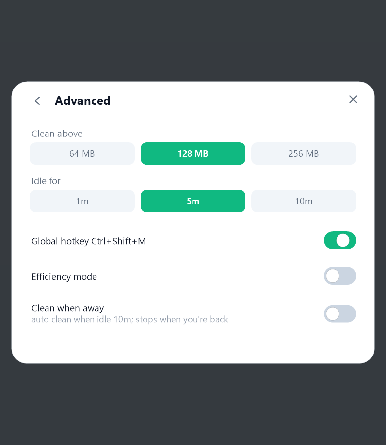

# MemSweep

<p align="center">
  <a href="README.md"><b>English</b></a> · <a href="README.zh-CN.md">简体中文</a>
</p>

<p align="center">
  
</p>

<p align="center">
  <strong>A Windows memory manager that only acts when memory is actually running out.</strong>
</p>

<p align="center">
  <a href="https://github.com/feiyu-labs/MemSweep/actions/workflows/ci.yml"></a>
  <a href="https://github.com/feiyu-labs/MemSweep/releases/latest"></a>
  <a href="LICENSE"></a>
  
  
  
  
</p>

<p align="center">
  <a href="#install">Install</a> ·
  <a href="#how-it-works">How it works</a> ·
  <a href="#command-line">Command line</a> ·
  <a href="#build-from-source">Build</a> ·
  <a href="CHANGELOG.md">Changelog</a> ·
  <a href="SECURITY.md">Security</a>
</p>

---

## Overview

MemSweep is a memory manager for Windows workstations that run close to their RAM limit all day — an IDE, a browser, an Electron app, a container or a virtual machine each holding a few gigabytes.

It does one job: when the system is genuinely short on memory, it returns pages held by background work that is not using them, so the foreground keeps running. It is a small tool with a deliberately narrow scope, and it is built to be boring — no drivers, no background services, no network, and no changes to system settings you did not ask for.

| | |
|:---|:---|
| **Scope** | Free pages held by idle background processes, standby cache, and duplicate physical pages |
| **Platform** | Windows 10 and 11, x64 and ARM64, native build for each |
| **Footprint** | 403 KB binary · 9.5 MB private working set while open · 3.0 MB settled in the tray |
| **Dependencies** | None. No .NET, no WebView2, no Visual C++ redistributable |
| **License** | MIT |

<table align="center">
  <tr>
    <th align="center">Light</th>
    <th align="center">Dark</th>
  </tr>
  <tr>
    <td></td>
    <td></td>
  </tr>
</table>

---

## How it works

### It waits for a real shortage

Automatic cleaning runs only when memory use is above your threshold **and** the system is actually running out — less than 512 MB available, or 95% of RAM in use. Windows keeping free RAM on the standby list is normal behaviour, not a shortage, and MemSweep does not treat it as one. This is the difference between a tool that helps and a tool that loops.

When an automatic pass actually reclaims something (64 MB or more) the tray reports it — at most once every ten minutes, never while the panel is open, and never in silent mode. Passes that find nothing to do stay completely quiet, and the line under the button says whether the last run was automatic or one you started.

Notifications are suppressed entirely whenever Windows reports that the user is not accepting them — a fullscreen game, presentation mode, Focus Assist — and also when the foreground window covers a whole monitor, which catches borderless fullscreen games that still report "accepts notifications". Nothing is queued while you are away; the tray tooltip and the panel line carry the information instead, and automatic-clean notifications are silent.

### It leaves what you are using alone

The focused window, its parent process chain, anything that had focus in the last two minutes, and critical system and virtualisation services are never trimmed. Neither are processes that were active in the last five minutes: only background processes with a working set above 128 MB and near-zero CPU time are candidates. A process is not trimmed twice within ten minutes unless it has grown by half again.

### It knows what not to touch

Some operations recover memory on paper and cost far more than they return. MemSweep does not perform them:

| Operation | Consequence |
|:---|:---|
| Flushing modified pages (`MemoryFlushModifiedList`) | Forces writes to disk, freezes the system for seconds, and reclaims almost nothing — the usual cause of "the cleaner made my PC hang" |
| Flushing registry caches | Disk I/O only; no reusable pages |
| `MemoryEmptyWorkingSets` across all processes | Trims the application you are typing into, then makes it fault every page back |
| Raising timer resolution | Breaks power management and shortens battery life for no measurable gain |
| Ending or suspending processes | Outside the scope of memory management |

### It can deduplicate physical memory

Windows can merge identical physical pages into copy-on-write references. MemSweep exposes that as an explicit action, with a kernel event handle that aborts the operation within milliseconds if you touch the keyboard or mouse. It is off by default and never runs on the automatic path, because a full scan can take 10–60 seconds.

<table align="center">
  <tr>
    <td align="center"><b>Settings</b></td>
    <td align="center"><b>Processes and protection</b></td>
  </tr>
  <tr>
    <td></td>
    <td></td>
  </tr>
  <tr>
    <td align="center"><b>System status</b></td>
    <td align="center"><b>Advanced settings</b></td>
  </tr>
  <tr>
    <td></td>
    <td></td>
  </tr>
</table>

The interface is a single 520×600 window. Settings, processes and system status open as sheets over it rather than as separate pages, and the two cards at the bottom show the current top memory consumer and the state of the memory subsystems at a glance.

MemSweep also reports the state of memory compression, page combining, SysMain, the pagefile and commit charge, with one-click repair for the first two if something else has disabled them.

### Changing the hotkey

The clean hotkey is yours to change. Open **Settings → Advanced → Global hotkey**, click the key chip, and press the combination you want. Holding only the modifiers previews `Ctrl+Alt…` without committing, `Esc` keeps the previous combination, and clicking away cancels.

The combination is validated against Windows rather than guessed: a missing modifier, a reserved key (`Alt+Tab`, `Alt+F4`, MemSweep's own `Ctrl+S`) or a combination another program already owns are each reported under the row, and recording stays open so you can simply try another. If a new combination cannot be registered, the previous one keeps working — the setting is only saved once registration succeeds.

<p align="center">
  
</p>

---

## Install

Download `MemSweep-v1.9.14-x64.zip` or `MemSweep-v1.9.14-arm64.zip` from [Releases](https://github.com/feiyu-labs/MemSweep/releases/latest), extract it, then right-click `install.cmd` and choose **Run as administrator**.

The script copies `MemSweep.exe` to `C:\Program Files\MemSweep\`, registers a logon scheduled task with the highest privileges available (so startup never shows a UAC prompt), creates a desktop shortcut and starts MemSweep in the tray.

To remove it, right-click `uninstall.cmd` and run it as administrator. Settings and logs stay in `%APPDATA%\MemSweep\`; delete that folder to leave nothing behind.

MemSweep also runs portably: start `MemSweep.exe` from any folder and it will keep its configuration in `%APPDATA%\MemSweep\config.ini`.

> [!NOTE]
> Purging system standby lists and trimming the file cache are privileged operations (`SeProfileSingleProcessPrivilege`, `SeIncreaseQuotaPrivilege`). That is why the installer registers a task instead of asking for elevation every time.

---

## Command line

```cmd
MemSweep.exe /clean          :: clean once, then exit
MemSweep.exe /dryrun         :: report what would be cleaned; change nothing
MemSweep.exe /combine        :: merge duplicate physical pages
MemSweep.exe /trimpid <PID>  :: trim one process
MemSweep.exe /pause          :: pause automatic cleaning for one hour
MemSweep.exe /resume         :: resume automatic cleaning
MemSweep.exe /tray           :: start in the tray (used by the logon task)
MemSweep.exe /show           :: open the window, or forward to the running instance
MemSweep.exe /selftest       :: run the policy engine self-test; exit code 0 on pass
MemSweep.exe /exit           :: shut down the running instance
```

---

## Measured footprint

Measured on Windows 11 26H2 (build 26340), i7-12800HX, 24 GB RAM, 150% display scaling. Memory figures are private working set as reported by Task Manager.

| State | Private working set | Working set | Private commit |
|:---|:---:|:---:|:---:|
| Window open | 9.5 MB | 17.0 MB | 12.2 MB |
| Minimised to tray | 6.0 MB | 8.4 MB | 9.2 MB |
| Tray, settled | **3.0 MB** | 3.6 MB | 9.6 MB |

The window's back buffer (780×900×4 bytes at this scaling) is destroyed when the window hides, which is most of the difference between the first two rows. Representative results from the cleaning paths:

| Operation | Result |
|:---|:---|
| Manual clean | +3,509 MB free, +1,128 MB available, 4.1 s |
| Low-priority standby purge | +991 MB free, 0.34 s |
| Page combining | 155,320 pages merged, about 607 MB |
| Away maintenance | 280,733 pages merged, about 1.1 GB, aborted on input |

The size of these numbers depends entirely on what is running; they are listed to show the order of magnitude each path works in, not as a promise.

---

## How MemSweep compares

Other memory tools are older, larger, or aimed at a different job. The differences that matter in daily use:

| | MemSweep | Mem Reduct | WinMemoryCleaner | Process Lasso (SmartTrim) | ISLC |
|:---|:---:|:---:|:---:|:---:|:---:|
| Binary size | 403 KB | ~350 KB | ~10 MB (.NET) | ~80 MB (suite) | ~1.5 MB |
| Tray memory | 3.0 MB | ~4.5 MB | ~35 MB | ~45 MB | ~18 MB |
| Foreground immunity | Window, parent chain, 120 s focus history | No | No | Exclusion list | No |
| Trigger checks true shortage | Yes | No | No | Partial | Partial |
| Modified-page flush | Never | Yes | Yes | No | No |
| Page combining | Yes, abortable | No | No | No | No |
| ARM64 build | Yes | No | No | Yes | No |

Rows describe published defaults and documented behaviour as of November 2026; competitors change, so check their documentation before relying on a row. If a tool you prefer is missing from the table, that is an omission, not a verdict.

---

## Build from source

MemSweep builds with [Zig](https://ziglang.org/) as the C++ toolchain, so a Visual Studio installation is not required.

```cmd
git clone https://github.com/feiyu-labs/MemSweep.git
cd MemSweep

build.cmd          :: release build  (dist\MemSweep.exe)
build.cmd test     :: dev build, self-test, idle check, headless UI renders
build.cmd arm64    :: Windows on ARM64
```

The pinned compiler is zig 0.17.1. Place it in `../tools/` next to the repository, or point the `ZIG` environment variable at `zig.exe`. Warnings are errors, and `build.cmd test` is the check CI runs.

---

## FAQ

**The percentage in Task Manager did not drop after cleaning.**
That percentage is in-use physical pages. If every background process is protected, focused or recently active, MemSweep deliberately leaves them alone; the clean then moves standby cache to the free list, which lowers allocation latency rather than the percentage. The panel reports free and available deltas instead of substituting a friendlier number.

**Can it lower committed memory?**
No, and no tool can. Commit is virtual memory promised to applications; trimming working sets moves pages between physical memory, standby and the pagefile. To reduce commit, close applications or lower heap limits (`-Xmx`, `--max-old-space-size`).

**Why is the binary so small?**
Three C++ translation units, compiled with `-Oz`, `-ffunction-sections`, `--gc-sections` and stripped symbols, linking only against Windows system libraries.

**Does it work with Windows 10?**
Yes. Development and testing happen on Windows 11, and the build targets Windows 10 and later.

---

## Privacy

MemSweep has no network code. It does not collect telemetry, does not check for updates, and does not send anything anywhere; the only outbound links in the application open a browser when you click them. Configuration and logs stay in `%APPDATA%\MemSweep\`.

---

## Community

Bug reports and pull requests are welcome. Read [CONTRIBUTING.md](CONTRIBUTING.md) before starting on a feature, and report security issues privately as described in [SECURITY.md](SECURITY.md). Design decisions and the reasoning behind the safety rules are documented in [docs/ENGINEERING.md](docs/ENGINEERING.md); the research behind the thresholds is in [RESEARCH.md](RESEARCH.md).

## License

[MIT](LICENSE) © feiyu-labs.
