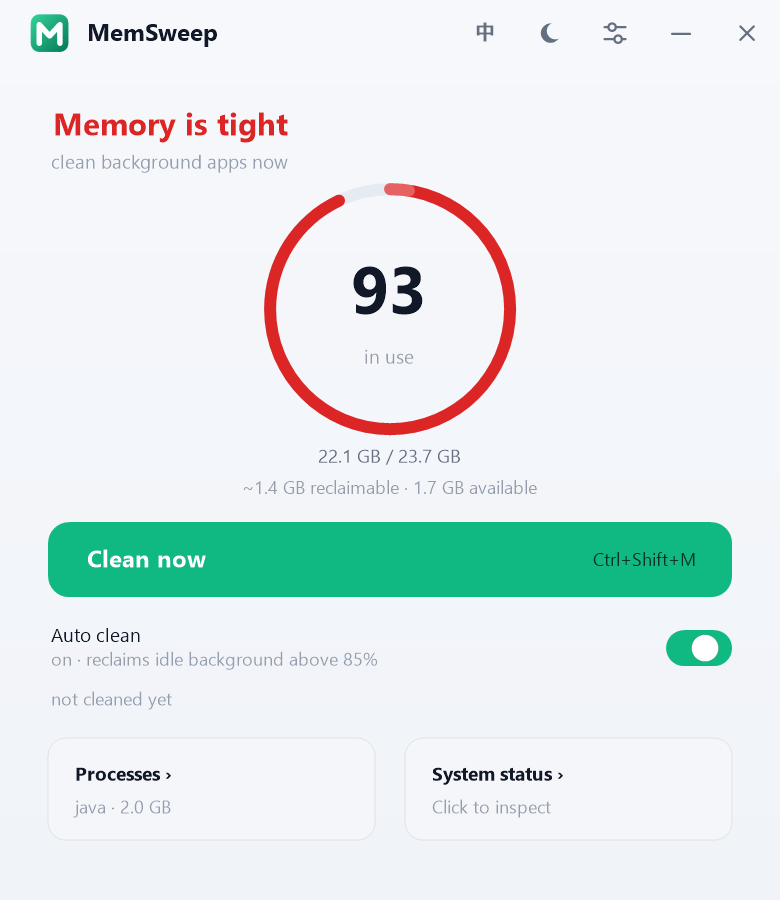
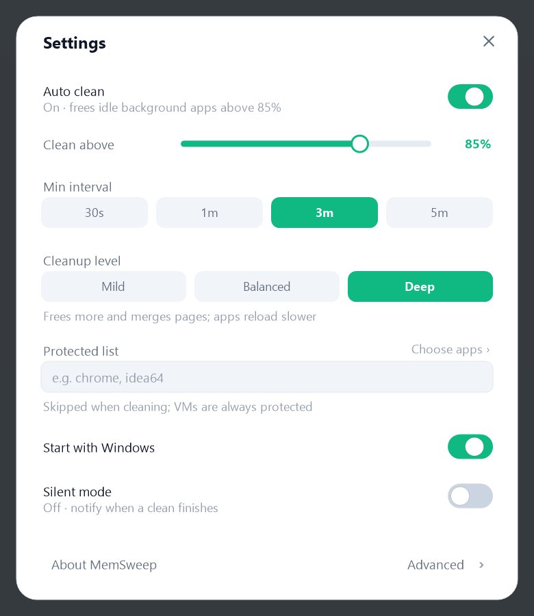

# MemSweep

<p align="center">
  <a href="README.md"><b>English</b></a> · <a href="README.zh-CN.md">简体中文</a>
</p>

<p align="center">
  
</p>

<p align="center">
  <strong>A lightweight, intelligent, and safe Windows memory manager.</strong>
</p>

<p align="center">
  <a href="https://github.com/feiyu-labs/MemSweep/actions/workflows/ci.yml"></a>
  <a href="https://github.com/feiyu-labs/MemSweep/releases/latest"></a>
  <a href="LICENSE"></a>
  
  
  
  
</p>

<table align="center">
  <tr>
    <th align="center">Light</th>
    <th align="center">Dark</th>
  </tr>
  <tr>
    <td></td>
    <td></td>
  </tr>
</table>

---

## Overview

**MemSweep** is a high-performance, ultra-lightweight Windows memory manager built for heavy workstations where RAM usage lives above 85–90% — the ones running IDEs, Electron applications, build toolchains and virtual machines all day.

Instead of fighting Windows' own caching, MemSweep distills the useful ideas of the last two decades of memory tools (Mem Reduct, Process Lasso SmartTrim, ISLC, WinMemoryCleaner) into one **tiered, conservative engine**. It tames runaway background processes while leaving whatever you are actually using untouched, and it removes the failure modes those tools are known for: full-system freezes, SSD write storms and foreground stutter.

- **No runtime dependencies.** Pure C++20, Win32 and GDI+. No .NET, no WebView2, no Electron. One standalone binary: 403,456 bytes (x64) / 340,480 bytes (ARM64).
- **Featherweight at rest.** 9.5 MB private working set with the window open (150% DPI, double buffer included); about 3.0 MB once settled in the tray.
- **Safe by construction.** Never force-flushes modified pages, never kills or suspends processes, never touches the active foreground window.
- **Fully offline.** No telemetry, no network access, no auto-updater, no bundled offers.

---

## Why MemSweep

| | MemSweep | Mem Reduct | WinMemoryCleaner | Process Lasso (SmartTrim) | ISLC |
|:---|:---:|:---:|:---:|:---:|:---:|
| **Binary size** | **403 KB** standalone | ~350 KB | ~10 MB (.NET) | ~80 MB (suite) | ~1.5 MB |
| **Tray RAM (private WS)** | **3.0 MB** | ~4.5 MB | ~35 MB+ | ~45 MB+ | ~18 MB |
| **Foreground immunity** | ✅ window + parent chain + 120 s focus history | ❌ none | ❌ none | ⚠️ exclusion list only | ❌ none |
| **True-depletion trigger** | ✅ free < 512 MB or used ≥ 95% | ❌ single threshold | ❌ available-based, loops | ⚠️ generic threshold | ⚠️ standby only |
| **No modified-page flush** | ✅ guaranteed | ❌ flushes | ❌ flushes | ✅ | ✅ |
| **Physical page deduplication** | ✅ kernel combine, abortable | ❌ | ❌ | ❌ | ❌ |
| **UI responsiveness** | ✅ 0 ms, all queries on workers | ⚠️ blocking Win32 | ❌ freezes under load | ✅ | ⚠️ |
| **Modern UI, dark theme** | ✅ frameless, DWM, animated | ❌ classic Win32 | ⚠️ basic WPF | ❌ dense legacy UI | ❌ WinForms |
| **Architectures** | ✅ x64 + ARM64 | ⚠️ x64/x86 | ⚠️ x64 | ✅ x64/ARM64 | ⚠️ x86/x64 |
| **License** | ✅ MIT | GPLv3 | MIT | ❌ closed | ❌ closed |

---

## Features

### 1. Tiered engine with a real depletion trigger

- **Trigger semantics.** Automatic cleaning runs only when `used ≥ threshold` **and** memory is genuinely exhausted (`available < 512 MB` or `used ≥ 95%`). Windows spending free RAM on the standby list is normal behaviour and is never treated as a shortage — that misconception is what makes other cleaners loop.
- **Foreground immunity.** The focused window, its whole parent chain, anything focused in the last 120 seconds, and critical system/VM services (WSL, QEMU) are never trimmed. Not one page.
- **Idle-aware trimming.** Under normal pressure only background processes with ≥ 300 s of near-zero CPU activity and a working set ≥ 128 MB are trimmed — the SmartTrim idea, built in.
- **Anti-thrash.** The same process is not trimmed twice within 10 minutes unless its working set grows by more than 1.5×.

### 2. What MemSweep refuses to do

| Dangerous action | Why it is never used |
|:---|:---|
| ❌ Flushing modified pages (`MemoryFlushModifiedList`) | The classic cause of multi-second full-system freezes; writes to SSD for almost no RAM gain. |
| ❌ Flushing registry caches | Pure disk I/O, zero pages reclaimed. |
| ❌ Global `MemoryEmptyWorkingSets` | Freezes the foreground application and triggers system-wide page-fault storms. |
| ❌ Timer-resolution hacks | Breaks Windows power management and drains laptop batteries. |
| ❌ Killing or suspending processes | A memory manager coordinates pages; it does not terminate your work. |

<table align="center">
  <tr>
    <td align="center"><b>Settings</b></td>
    <td align="center"><b>Processes &amp; protection</b></td>
  </tr>
  <tr>
    <td></td>
    <td></td>
  </tr>
</table>

### 3. Physical page deduplication

- Uses the NT kernel page-combining facility (`SystemCombinePhysicalMemoryInformation`) to find identical physical pages and merge them into copy-on-write references.
- **Away maintenance (opt-in).** When the session has been idle for 10 minutes and memory is high, it runs in the background and **aborts within milliseconds** of any keyboard or mouse input via a kernel event handle.

### 4. "One Screen" interface

- **520×600 frameless window**, GDI+ double buffering, DWM rounded corners and shadow.
- **Twin foundation cards.** The bottom of the home screen holds two compact cards showing the current top memory consumer (e.g. `idea64 · 3.2 GB`) and a system-health summary, so the layout stays anchored and the two secondary views are one click away.
- **Modal sheets, not pages.** Settings, processes and system status open as 200 ms ease-out sheets over the main screen.
- **Measured motion budget.** The ambient gauge sweep runs at 6.7 fps and costs under 1.6% of one core while visible; the timers stop entirely when hidden.
- **Instant theme and language toggles** in the title bar.

### 5. System health diagnostics

- One click reports memory compression, page combining, SysMain, pagefile configuration, commit charge and non-paged pool, with one-tap repair actions for compression and combining.

<table align="center">
  <tr>
    <td align="center"><b>System status</b></td>
    <td align="center"><b>Advanced settings</b></td>
  </tr>
  <tr>
    <td></td>
    <td></td>
  </tr>
</table>

---

## Download

Grab the latest package from [**GitHub Releases**](https://github.com/feiyu-labs/MemSweep/releases/latest):

- `MemSweep-v1.9.11-x64.zip` — Intel / AMD
- `MemSweep-v1.9.11-arm64.zip` — Snapdragon / Windows on ARM

Each zip contains `MemSweep.exe`, `install.cmd`, `uninstall.cmd`, `INSTALL.txt` and `LICENSE`, with a matching `.sha256` file.

### Install

1. Extract the archive anywhere.
2. Right-click `install.cmd` → **Run as administrator**.

The script copies `MemSweep.exe` to `C:\Program Files\MemSweep\`, registers a logon scheduled task with highest privileges (so daily startup never shows a UAC prompt), creates a desktop shortcut and starts MemSweep in the tray.

### Uninstall

Right-click `uninstall.cmd` → **Run as administrator**. Configuration and logs stay in `%APPDATA%\MemSweep\` — delete that folder to remove every trace.

### Portable

Run `MemSweep.exe` from any folder; settings live in `%APPDATA%\MemSweep\config.ini`.

---

## Command line

```cmd
MemSweep.exe /clean          :: one-shot intelligent clean, then exit
MemSweep.exe /dryrun         :: report what would be cleaned, change nothing
MemSweep.exe /combine        :: kernel physical page deduplication
MemSweep.exe /trimpid <PID>  :: trim the working set of one process
MemSweep.exe /pause          :: pause automatic cleaning for one hour
MemSweep.exe /resume         :: resume automatic cleaning
MemSweep.exe /tray           :: start hidden in the tray (used by the scheduled task)
MemSweep.exe /show           :: open the window, forwarding to a running instance
MemSweep.exe /selftest       :: run the policy engine self-test (exit code 0 on pass)
MemSweep.exe /exit           :: shut down the running instance
```

---

## Measured behaviour

Windows 11 26H2 (build 26340), i7-12800HX, 24 GB RAM, 150% scaling:

| State / operation | Private working set | Working set | Private commit | Notes |
|:---|:---:|:---:|:---:|:---|
| Window open | **9.5 MB** | 17.0 MB | 12.2 MB | 780×900×4 double buffer included |
| Minimised to tray | 6.0 MB | 8.4 MB | 9.2 MB | Back buffer destroyed, heap compacted |
| Tray, settled | **3.0 MB** | 3.6 MB | 9.6 MB | Idle watchdog |
| Manual clean | — | — | — | **+3,509 MB free, +1,128 MB available, 4.1 s** |
| Low-priority standby purge | — | — | — | **+991 MB free, 0.34 s** |
| Page combining | — | — | — | **155,320 pages merged (~607 MB)** |
| Away maintenance | — | — | — | **280,733 pages (~1.1 GB), aborted on input** |

---

## Build from source

MemSweep builds with [Zig](https://ziglang.org/) as the C++ toolchain, so no Visual Studio installation is required:

```cmd
git clone https://github.com/feiyu-labs/MemSweep.git
cd MemSweep

build.cmd          :: release build  (dist\MemSweep.exe)
build.cmd test     :: dev build + selftest + idle check + headless UI renders
build.cmd arm64    :: Windows on ARM64
```

The pinned compiler is `zig 0.17.1`; place it at `../tools/` next to the repository or point the `ZIG` environment variable at `zig.exe`. Warnings are errors (`-Werror`), and `build.cmd test` is the regression gate used by CI.

---

## FAQ

**Why doesn't the percentage drop after cleaning?**
Task Manager shows *in-use physical pages*. If every background process is protected, focused or recently active, MemSweep deliberately leaves them alone; the clean then moves standby cache into the free list, which lowers allocation latency rather than the percentage. MemSweep reports the real free and available deltas instead of inventing a number.

**Does it reduce committed memory?**
No, and no cleaner can. Commit is virtual memory promised to applications. Trimming working sets moves pages to standby or the pagefile. To lower commit, close applications or tighten heap limits (`-Xmx`, `--max-old-space-size`).

**Why does it need administrator rights?**
Purging system standby lists and trimming the file cache are privileged NT operations (`SeProfileSingleProcessPrivilege`, `SeIncreaseQuotaPrivilege`). The installer registers a logon task with highest privileges so daily use never prompts.

**Why is the binary so small?**
It is 3 C++ translation units compiled with `-Oz`, `-ffunction-sections`, `--gc-sections` and stripped symbols, linking only against Windows system libraries.

---

## License

[MIT](LICENSE) © feiyu-labs. Terminology and mechanism research is documented in [RESEARCH.md](RESEARCH.md); engineering invariants live in [docs/ENGINEERING.md](docs/ENGINEERING.md). Issues and pull requests are welcome — see [CONTRIBUTING.md](CONTRIBUTING.md).
