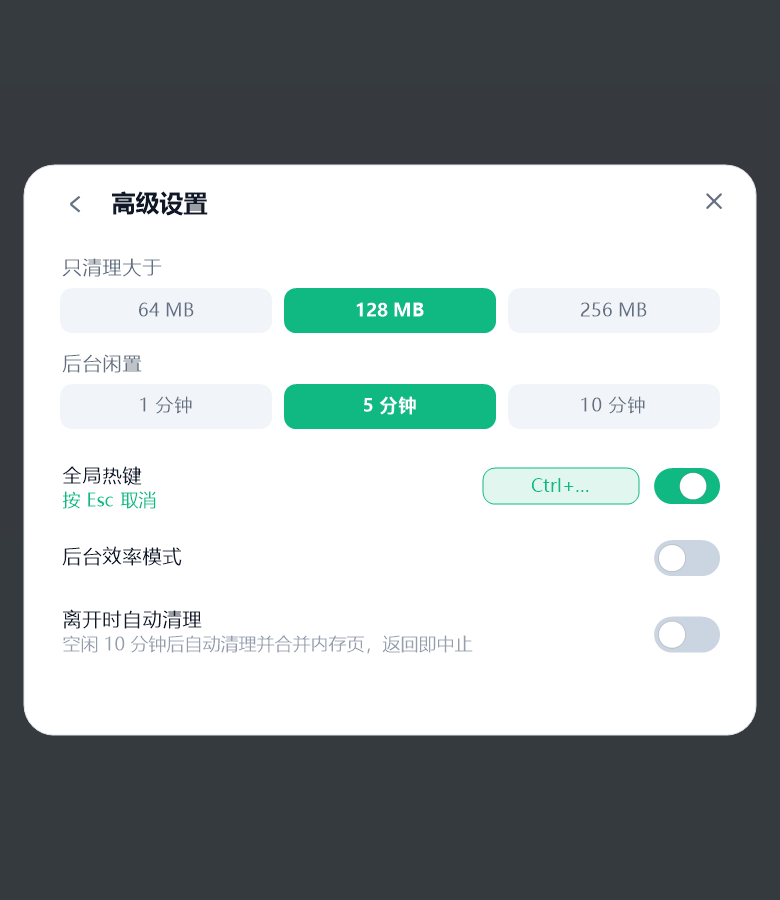

# MemSweep

<p align="center">
  <a href="README.md">English</a> · <a href="README.zh-CN.md"><b>简体中文</b></a>
</p>

<p align="center">
  
</p>

<p align="center">
  <strong>回收内存，不打断你的工作。</strong>
</p>

<p align="center">
  <a href="https://github.com/feiyu-labs/MemSweep/actions/workflows/ci.yml"></a>
  <a href="https://github.com/feiyu-labs/MemSweep/releases/latest"></a>
  <a href="LICENSE"></a>
  
  
  
  
</p>

<p align="center">
  <a href="#安装">安装</a> ·
  <a href="#特性">特性</a> ·
  <a href="#命令行">命令行</a> ·
  <a href="#占用">占用</a> ·
  <a href="#从源码构建">构建</a> ·
  <a href="CHANGELOG.md">更新日志</a>
</p>

<table align="center">
  <tr>
    <th align="center">浅色</th>
    <th align="center">深色</th>
  </tr>
  <tr>
    <td></td>
    <td></td>
  </tr>
</table>

## 这是什么

MemSweep 在 Windows 真正吃紧时，把闲置后台进程占用的内存收回来，正在用的应用保持原来的速度。

它不做那些让同类工具变得不可靠的事：不刷写修改页、不全局清空工作集、不结束进程、不常驻服务、不联网。

| | |
|:---|:---|
| **平台** | Windows 10 / 11，x64 与 ARM64 各自原生构建 |
| **体积** | 403 KB 单文件，无运行时依赖 |
| **占用** | 面板 9.5 MB · 托盘 3.0 MB |
| **许可** | MIT |

## 特性

- **回收后台，不碰前台。** 焦点窗口、它的父进程链、两分钟内有过焦点的应用，以及系统与虚拟化服务，每一轮都排除在外；后台进程连续五分钟 CPU 近乎零活动才进入候选。
- **按压力判断，不按百分比。** 占用越过阈值**并且**系统确实吃紧（可用低于 512 MB 或已用超过 95%）时才开始；内存停在已缓存列表上是 Windows 的正常行为，不是清理信号。
- **跳过所有会造成卡死的操作。** 不刷写修改页、不刷注册表缓存、不做全局工作集清空、不改定时器分辨率、不结束进程。
- **可按需合并重复的物理页**，内核句柄在你的第一次按键时中止。
- **从不打扰。** 全屏游戏、演示模式、专注助手打开时不发通知；自动清理只在真的释放了内存时报告。
- **一个窗口，零依赖。** 403 KB、托盘 3.0 MB、双主题、双语言、热键可改。

<table align="center">
  <tr>
    <td align="center"><b>设置</b></td>
    <td align="center"><b>进程与保护</b></td>
  </tr>
  <tr>
    <td></td>
    <td></td>
  </tr>
  <tr>
    <td align="center"><b>系统状态</b></td>
    <td align="center"><b>设置热键</b></td>
  </tr>
  <tr>
    <td></td>
    <td></td>
  </tr>
</table>

## 安装

从 [Releases](https://github.com/feiyu-labs/MemSweep/releases/latest) 下载 `MemSweep-v1.9.14-x64.zip` 或 `MemSweep-v1.9.14-arm64.zip`，解压后右键 `install.cmd`，选择**以管理员身份运行**。

脚本把 `MemSweep.exe` 复制到 `C:\Program Files\MemSweep\`，注册一个最高权限的登录任务（开机不弹 UAC），创建桌面快捷方式，并让 MemSweep 进入托盘。

卸载时以管理员身份运行 `uninstall.cmd`。配置与日志保留在 `%APPDATA%\MemSweep\`。

也可以绿色运行：从任意目录启动 `MemSweep.exe`，配置保存在 `%APPDATA%\MemSweep\config.ini`。

## 命令行

```cmd
MemSweep.exe /clean          :: 清理一次后退出
MemSweep.exe /dryrun         :: 只报告将要清理什么，不改动内存
MemSweep.exe /combine        :: 合并重复的物理页
MemSweep.exe /trimpid <PID>  :: 修剪单个进程
MemSweep.exe /pause          :: 暂停自动清理一小时
MemSweep.exe /resume         :: 恢复自动清理
MemSweep.exe /tray           :: 静默进入托盘（登录任务使用）
MemSweep.exe /show           :: 打开窗口，或转发给正在运行的实例
MemSweep.exe /selftest       :: 运行策略引擎自检，通过返回 0
MemSweep.exe /exit           :: 退出正在运行的实例
```

## 占用

Windows 11 26H2（26340）、i7-12800HX、24 GB 内存、150% 缩放。数字为任务管理器中的专用工作集。

| 状态 | 专用工作集 | 私有提交 |
|:---|:---:|:---:|
| 面板打开 | 9.5 MB | 12.2 MB |
| 最小化到托盘 | 6.0 MB | 9.2 MB |
| 托盘稳定 | **3.0 MB** | 9.6 MB |

本机一次手动清理回收过 1–3 GB 空闲页；具体多少取决于当时在跑什么。

## 与同类工具的区别

| | MemSweep | Mem Reduct | WinMemoryCleaner | Process Lasso (SmartTrim) | ISLC |
|:---|:---:|:---:|:---:|:---:|:---:|
| 体积 | 403 KB | ~350 KB | ~10 MB（.NET） | ~80 MB（套件） | ~1.5 MB |
| 托盘占用 | 3.0 MB | ~4.5 MB | ~35 MB | ~45 MB | ~18 MB |
| 前台免疫 | 窗口、父进程链、120 秒焦点历史 | 无 | 无 | 排除名单 | 无 |
| 按压力触发 | 是 | 否 | 否 | 部分 | 部分 |
| 刷写修改页 | 从不 | 会 | 会 | 不会 | 不会 |
| 物理页合并 | 有，可中止 | 无 | 无 | 无 | 无 |
| ARM64 构建 | 有 | 无 | 无 | 有 | 无 |

表中描述的是各工具截至 2026 年 11 月的默认设置与已记录行为；同类工具会更新，引用前请核对它们的文档。

## 从源码构建

MemSweep 使用 [Zig](https://ziglang.org/) 作为 C++ 工具链，不需要安装 Visual Studio。

```cmd
git clone https://github.com/feiyu-labs/MemSweep.git
cd MemSweep

build.cmd          :: 正式版（dist\MemSweep.exe）
build.cmd test     :: 开发版、自检、空闲检查、无头界面渲染
build.cmd arm64    :: Windows on ARM64
```

编译器固定为 zig 0.17.1：放在仓库同级 `../tools/`，或用 `ZIG` 环境变量指向 `zig.exe`。编译开启 `-Werror`，`build.cmd test` 就是 CI 执行的那套检查。

## 常见问题

**清理之后任务管理器里的百分比没降。**
那个数字是「使用中」物理页。当后台进程受到保护或刚活跃过，MemSweep 改为回收已缓存，缩短的是下一次内存分配，而不是这个百分比。

**能降低已提交内存吗？**
不能。已提交是分配给应用的虚拟内存承诺，修剪只是在物理内存、已缓存和分页文件之间搬页面。要降低它，只能关闭应用或收紧堆上限（`-Xmx`、`--max-old-space-size`）。

**为什么需要管理员权限？**
清理待机列表和系统文件缓存是受保护的 NT 操作。安装脚本注册了登录任务，日常使用不会弹 UAC。

## 隐私

没有网络代码：不收集遥测、不检查更新、数据不出本机。应用里唯一的对外链接需要你点击才会打开浏览器。配置和日志都留在 `%APPDATA%\MemSweep\`。

## 参与

欢迎提交问题与改进，请先读 [CONTRIBUTING.md](CONTRIBUTING.md)；安全问题的私下报告方式见 [SECURITY.md](SECURITY.md)。设计取舍记录在 [docs/ENGINEERING.md](docs/ENGINEERING.md)，阈值背后的调研记录在 [RESEARCH.md](RESEARCH.md)。

## 许可

[MIT](LICENSE) © feiyu-labs。