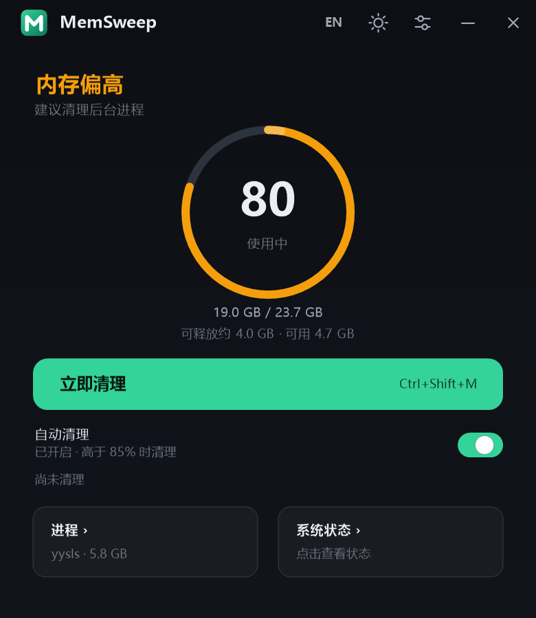
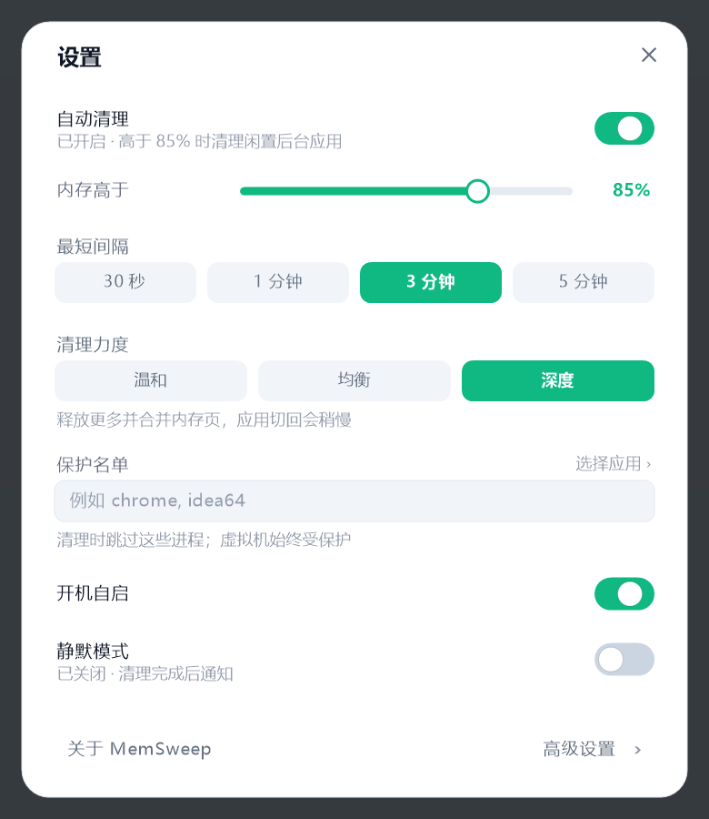
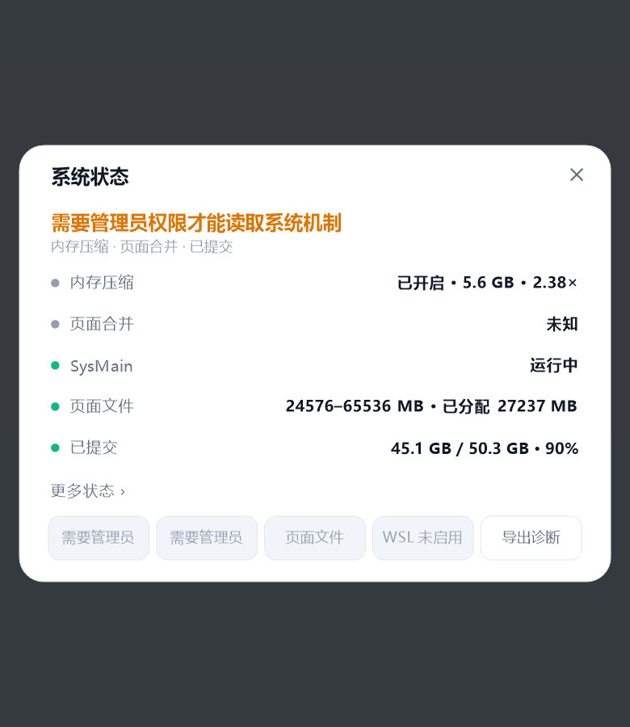
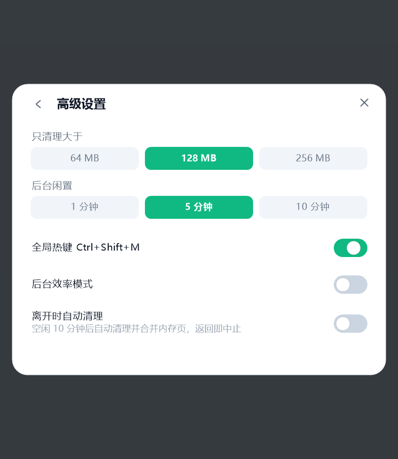

# MemSweep

<p align="center">
  <a href="README.md">English</a> · <a href="README.zh-CN.md"><b>简体中文</b></a>
</p>

<p align="center">
  
</p>

<p align="center">
  <strong>轻量、智能、安全的 Windows 原生内存管理工具。</strong>
</p>

<p align="center">
  <a href="https://github.com/feiyu-labs/MemSweep/actions/workflows/ci.yml"></a>
  <a href="https://github.com/feiyu-labs/MemSweep/releases/latest"></a>
  <a href="LICENSE"></a>
  
  
  
  
</p>

<table align="center">
  <tr>
    <th align="center">浅色</th>
    <th align="center">深色</th>
  </tr>
  <tr>
    <td></td>
    <td></td>
  </tr>
</table>

---

## 概览

**MemSweep** 面向的是内存长期运行在 85–90% 以上的重度工作机：同时开着 IDE、Electron 应用、编译工具链和虚拟机，Windows 自己的缓存机制在这种负载下只能勉强维持。

MemSweep 不跟系统缓存对抗。它把过去二十年内存工具的可用经验（Mem Reduct、Process Lasso SmartTrim、ISLC、WinMemoryCleaner）收敛成一套**分层、克制的引擎**：只处理真正失控的后台进程，绝不碰你正在用的东西，并彻底去掉了这类工具众所周知的三类事故——全机卡死、SSD 写入风暴、前台抖动。

- **零第三方运行时**：纯 C++20 + Win32 + GDI+，不依赖 .NET、WebView2、Electron。单文件 403,456 字节（x64）/ 340,480 字节（ARM64）。
- **占用极低**：面板打开时专用工作集 9.5 MB（含 150% 缩放下的双缓冲），托盘稳定后约 3.0 MB。
- **安全边界明确**：不强刷脏页、不结束或挂起进程、不触碰当前前台窗口。
- **完全离线**：无遥测、无联网、无自动更新、无捆绑推荐。

---

## 为什么选 MemSweep

| | MemSweep | Mem Reduct | WinMemoryCleaner | Process Lasso (SmartTrim) | ISLC |
|:---|:---:|:---:|:---:|:---:|:---:|
| **体积** | **403 KB** 单文件 | ~350 KB | ~10 MB (.NET) | ~80 MB（套件） | ~1.5 MB |
| **托盘专用工作集** | **3.0 MB** | ~4.5 MB | ~35 MB+ | ~45 MB+ | ~18 MB |
| **前台免疫** | ✅ 窗口 + 父进程链 + 120 秒焦点历史 | ❌ 无 | ❌ 无 | ⚠️ 仅排除名单 | ❌ 无 |
| **真实枯竭判定** | ✅ 可用 < 512 MB 或已用 ≥ 95% | ❌ 单一阈值 | ❌ 按可用比例，会自循环 | ⚠️ 通用阈值 | ⚠️ 仅看待机 |
| **不刷写修改页** | ✅ 保证 | ❌ 会刷 | ❌ 会刷 | ✅ | ✅ |
| **物理页合并** | ✅ 内核级，可中断 | ❌ | ❌ | ❌ | ❌ |
| **界面响应** | ✅ 0 ms，查询全在工作线程 | ⚠️ 同步阻塞 | ❌ 高负载下卡死 | ✅ | ⚠️ |
| **现代界面与深色主题** | ✅ 无边框 + 圆角 + 动效 | ❌ 传统 Win32 | ⚠️ 基础 WPF | ❌ 密集旧式界面 | ❌ WinForms |
| **架构** | ✅ x64 + ARM64 | ⚠️ x64/x86 | ⚠️ x64 | ✅ x64/ARM64 | ⚠️ x86/x64 |
| **许可** | ✅ MIT | GPLv3 | MIT | ❌ 闭源 | ❌ 闭源 |

---

## 核心特性

### 1. 分层引擎与真实枯竭判定

- **触发语义**：仅在 `已用 ≥ 阈值` **且**内存真实枯竭（可用 < 512 MB 或已用 ≥ 95%）时才自动清理。Windows 把空闲内存用作已缓存是正常现象，不该被当成内存不足——这正是其他清理工具反复自循环的根因。
- **前台免疫**：当前焦点窗口、其完整父进程链、最近 120 秒内获得过焦点的应用，以及系统关键服务与虚拟机（WSL、QEMU）一律不碰。
- **空闲判定**：常规压力下只修剪后台、CPU 低活动持续 300 秒以上、且工作集 ≥ 128 MB 的进程，即 SmartTrim 思路的内置实现。
- **防抖动**：同一进程 10 分钟内不会重复修剪，除非工作集增长超过 1.5 倍。

### 2. 明确不会做的事

| 危险操作 | 为什么不做 |
|:---|:---|
| ❌ 刷写修改页（`MemoryFlushModifiedList`） | 全机卡死数秒的经典元凶；大量写盘，内存收益极小。 |
| ❌ 刷写注册表缓存 | 纯磁盘 I/O，回收不到任何页面。 |
| ❌ 全局 `MemoryEmptyWorkingSets` | 冻结前台应用，引发全系统缺页风暴。 |
| ❌ 修改系统定时器分辨率 | 破坏电源管理，笔记本续航直接受损。 |
| ❌ 结束或挂起进程 | 内存管理负责协调页面，不负责终止你的工作。 |

<table align="center">
  <tr>
    <td align="center"><b>设置</b></td>
    <td align="center"><b>进程与保护</b></td>
  </tr>
  <tr>
    <td></td>
    <td></td>
  </tr>
</table>

### 3. 物理页去重合并

- 调用 NT 内核的页面合并机制（`SystemCombinePhysicalMemoryInformation`），把内容完全相同的物理页合并为写时复制引用。
- **离开时自动维护（可选）**：会话空闲 10 分钟且内存偏高时后台执行，一旦检测到键盘或鼠标输入，通过内核事件在毫秒级中止。

### 4. "One Screen" 界面

- **520×600 无边框窗口**，GDI+ 双缓冲、DWM 圆角与投影。
- **底座双微卡片**：主屏底部两张紧凑卡片，分别显示当前最占内存的应用（如 `idea64 · 3.2 GB`）与系统健康摘要，让页面重心稳定，两个次级视图一步可达。
- **Sheet 而非页面**：设置、进程、系统状态都以 200 ms ease-out 浮层盖在主屏上。
- **动效预算可控**：仪表盘环境光泽 6.7 fps，可见时不超过单核 1.6%，隐藏后定时器全部停止。
- **主题与语言即时切换**，无需重启。

### 5. 系统状态体检

- 一键查看内存压缩、页面合并、SysMain、分页文件、已提交与内核内存，并对压缩和页面合并提供一键修复。

<table align="center">
  <tr>
    <td align="center"><b>系统状态</b></td>
    <td align="center"><b>高级设置</b></td>
  </tr>
  <tr>
    <td></td>
    <td></td>
  </tr>
</table>

---

## 下载

从 [**GitHub Releases**](https://github.com/feiyu-labs/MemSweep/releases/latest) 获取最新版本：

- `MemSweep-v1.9.11-x64.zip` —— Intel / AMD
- `MemSweep-v1.9.11-arm64.zip` —— 骁龙 / Windows on ARM

压缩包内含 `MemSweep.exe`、`install.cmd`、`uninstall.cmd`、`INSTALL.txt` 与 `LICENSE`，并附同名 `.sha256` 校验文件。

### 安装

1. 解压到任意目录。
2. 右键 `install.cmd` → **以管理员身份运行**。

脚本会把 `MemSweep.exe` 复制到 `C:\Program Files\MemSweep\`，注册最高权限的登录计划任务（日常开机不再出现 UAC 提示），创建桌面快捷方式并让 MemSweep 进入托盘。

### 卸载

右键 `uninstall.cmd` → **以管理员身份运行**。配置与日志保留在 `%APPDATA%\MemSweep\`，删除该目录即可彻底清除。

### 绿色版

直接运行 `MemSweep.exe` 即可，配置保存在 `%APPDATA%\MemSweep\config.ini`。

---

## 命令行

```cmd
MemSweep.exe /clean          :: 单次智能清理后退出
MemSweep.exe /dryrun         :: 只报告将要清理什么，不改动内存
MemSweep.exe /combine        :: 内核物理页去重合并
MemSweep.exe /trimpid <PID>  :: 修剪指定进程的工作集
MemSweep.exe /pause          :: 暂停自动清理一小时
MemSweep.exe /resume         :: 恢复自动清理
MemSweep.exe /tray           :: 静默进入托盘（计划任务使用）
MemSweep.exe /show           :: 打开面板，已运行则转发
MemSweep.exe /selftest       :: 策略引擎自检（通过返回 0）
MemSweep.exe /exit           :: 退出正在运行的实例
```

---

## 实测数据

Windows 11 26H2（26340）、i7-12800HX、24 GB 内存、150% 缩放：

| 状态 / 操作 | 专用工作集 | 工作集 | 私有提交 | 说明 |
|:---|:---:|:---:|:---:|:---|
| 面板打开 | **9.5 MB** | 17.0 MB | 12.2 MB | 含 780×900×4 双缓冲 |
| 最小化到托盘 | 6.0 MB | 8.4 MB | 9.2 MB | 双缓冲销毁并压缩堆 |
| 托盘稳定 | **3.0 MB** | 3.6 MB | 9.6 MB | 空闲看门狗 |
| 手动清理 | — | — | — | **空闲 +3,509 MB，可用 +1,128 MB，4.1 秒** |
| 低优先级缓存释放 | — | — | — | **空闲 +991 MB，0.34 秒** |
| 页面合并 | — | — | — | **合并 155,320 页（约 607 MB）** |
| 离开时维护 | — | — | — | **合并 280,733 页（约 1.1 GB），有输入即中止** |

---

## 从源码构建

MemSweep 使用 [Zig](https://ziglang.org/) 作为 C++ 工具链，无需安装 Visual Studio：

```cmd
git clone https://github.com/feiyu-labs/MemSweep.git
cd MemSweep

build.cmd          :: 正式版（dist\MemSweep.exe）
build.cmd test     :: 开发版 + 自检 + 空闲检查 + 无头界面渲染
build.cmd arm64    :: Windows on ARM64
```

编译器固定为 `zig 0.17.1`，放在仓库同级 `../tools/`，或用 `ZIG` 环境变量指向 `zig.exe`。编译开启 `-Werror`，`build.cmd test` 即 CI 使用的回归门槛。

---

## 常见问题

**清理后百分比为什么没降？**
任务管理器显示的是「使用中」物理页。如果后台进程都在前台、受保护或刚刚活跃过，MemSweep 会刻意不动它们；此时清理把已缓存转入空闲列表，降低的是后续分配的延迟而不是百分比。界面汇报的是真实的空闲与可用增量，不做数字修饰。

**能降低已提交内存吗？**
不能，任何清理工具都不能。已提交是分配给应用的虚拟内存承诺，修剪工作集只是把页面挪到已缓存或分页文件。要降低已提交，只能关闭应用或收紧堆上限（`-Xmx`、`--max-old-space-size`）。

**为什么需要管理员权限？**
清理系统待机列表与系统文件缓存是受保护的 NT 操作（`SeProfileSingleProcessPrivilege`、`SeIncreaseQuotaPrivilege`）。安装脚本注册最高权限登录任务，日常使用不会弹 UAC。

**为什么体积这么小？**
三个 C++ 编译单元，使用 `-Oz`、`-ffunction-sections`、`--gc-sections` 并剥离符号，只链接 Windows 系统库。

---

## 许可

[MIT](LICENSE) © feiyu-labs。术语与机制调研记录在 [RESEARCH.md](RESEARCH.md)，工程约束见 [docs/ENGINEERING.md](docs/ENGINEERING.md)。欢迎提交 Issue 与 Pull Request，请先阅读 [CONTRIBUTING.md](CONTRIBUTING.md)。
