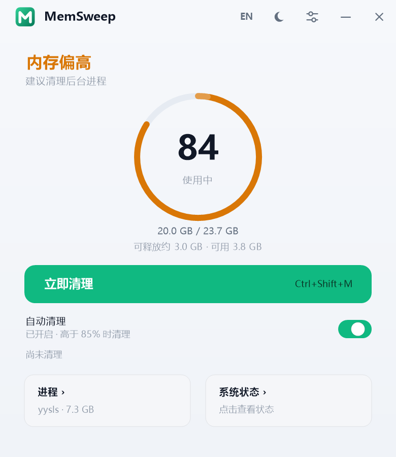

# MemSweep

<p align="center">
  <a href="README.md">English</a> · <a href="README.zh-CN.md"><b>简体中文</b></a>
</p>

<p align="center">
  
</p>

<p align="center">
  <strong>Windows 内存清理工具。回收闲置后台进程占用的内存，你正在用的程序不受影响。</strong>
</p>

<p align="center">
  <a href="https://github.com/feiyu-labs/MemSweep/releases/latest"><b>下载 Windows 版</b></a><br>
  Windows 10 / 11 · x64 与 ARM64 · 398 KB
</p>

<p align="center">
  <a href="https://github.com/feiyu-labs/MemSweep/actions/workflows/ci.yml"></a>
  <a href="https://github.com/feiyu-labs/MemSweep/releases/latest"></a>
  <a href="LICENSE"></a>
  
  
  
  
</p>

<p align="center">
  <a href="#安装">安装</a> ·
  <a href="#特性">特性</a> ·
  <a href="#与同类工具的区别">与同类工具的区别</a> ·
  <a href="#命令行">命令行</a> ·
  <a href="#占用">占用</a> ·
  <a href="#常见问题">常见问题</a> ·
  <a href="#隐私">隐私</a> ·
  <a href="#从源码构建">构建</a> ·
  <a href="#规划">规划</a> ·
  <a href="CHANGELOG.md">更新日志</a>
</p>

<table align="center">
  <tr>
    <th align="center">浅色</th>
    <th align="center">深色</th>
  </tr>
  <tr>
    <td></td>
    <td></td>
  </tr>
</table>

## 这是什么

MemSweep 回收闲置后台进程占用的内存，你正在用的程序不受影响。它是一个 398 KB 的单个 exe，不装驱动，不跑后台服务，也不联网。

同类工具常见的做法是刷写修改页或按固定时间清遍所有进程，容易把桌面卡死。MemSweep 等到内存真的紧张时才动作，只动闲置后台应用，并把释放了多少写进日志。

| | |
|:---|:---|
| **平台** | Windows 10 / 11，提供原生 x64 与 ARM64 版本 |
| **体积** | 398 KB 单文件，不依赖任何运行库 |
| **占用** | 打开面板 9.5 MB · 托盘常驻 3.0 MB |
| **权限** | 清理内存需要管理员权限；安装脚本会建开机任务，平时使用不弹 UAC |
| **许可** | MIT |

## 特性

- **自动清理只动闲置的后台应用。** 你正在用的窗口、启动它的进程，以及最近两分钟碰过的程序都会跳过。后台应用连续五分钟几乎不用 CPU 才会被清理（时间可在设置里调）。系统压缩占用较高时，MemSweep 会拉长重复清理的间隔，避免应用刚清完又弹回来。
- **把真正的内存瓶颈清理干净。** 使用中超过你设的阈值（默认 85%）或内存吃紧时自动开始。当空闲页长期见底而高优先级「已缓存」里还积压着数 GB 时，只要磁盘换页平稳，自动清理每隔十分钟会清一次全量待机缓存，不再空跑 0 MB。
- **后台效率模式同时管住 CPU、磁盘和内存抢占。** 在高级设置里打开后，非前台的高占用后台进程会暂时降低 CPU 与 I/O 优先级；等它闲下来或你切回这个窗口时，立刻自动恢复正常。
- **多进程应用合并显示。** 浏览器和开发工具的几十个子进程会按应用合并汇总，一眼看出是谁占满了内存，左键一键保护整个应用，右键一次释放它全部后台实例的内存。
- **会导致卡死的操作，它不做。** 不刷写修改页、不清注册表缓存、不全局清空所有工作集、不改系统定时器，也不结束进程。
- **重复的内存页可以合并。** 内容相同的物理页会合并成一份；在「深度」清理或离开时开启，按下任意键立刻停下。
- **它能查看 Windows 的内存机制。** 系统状态页面显示内存压缩、页面合并、SysMain、页面文件、已提交、内核内存和 WSL 内存回收，还能导出诊断文件。
- **一个 398 KB 的 exe。** 不用装运行库，托盘常驻约 3 MB，玩游戏或演示时不打扰，支持深浅主题、中英文切换和自定义全局热键（默认 Ctrl+Shift+M）。

<table align="center">
  <tr>
    <td align="center"><b>设置</b></td>
    <td align="center"><b>进程与保护</b></td>
  </tr>
  <tr>
    <td></td>
    <td></td>
  </tr>
  <tr>
    <td align="center"><b>系统状态</b></td>
    <td align="center"><b>设置热键</b></td>
  </tr>
  <tr>
    <td></td>
    <td></td>
  </tr>
</table>

## 安装

从 [Releases](https://github.com/feiyu-labs/MemSweep/releases/latest) 下载 `MemSweep-v2.0.4-x64.zip` 或 `MemSweep-v2.0.4-arm64.zip`，解压后右键 `install.cmd`，选择**以管理员身份运行**。

脚本会把 `MemSweep.exe` 复制到 `C:\Program Files\MemSweep\`，建一个高权限登录任务（开机不弹 UAC），加一个桌面快捷方式，然后启动到托盘。

卸载时右键 `uninstall.cmd`，选择**以管理员身份运行**。配置和日志保留在 `%APPDATA%\MemSweep\`。

如果想把配置和日志放在程序同目录带走，首次启动前在 `MemSweep.exe` 旁边建一个空文件 `MemSweep.ini` 即可。

## 命令行

```cmd
MemSweep.exe /clean          :: 清理一次后退出
MemSweep.exe /dryrun         :: 只输出将会清理什么，不改动内存
MemSweep.exe /combine        :: 合并重复的物理页
MemSweep.exe /trimpid <PID>  :: 修剪单个进程
MemSweep.exe /pause          :: 暂停自动清理 1 小时
MemSweep.exe /resume         :: 恢复自动清理
MemSweep.exe /tray           :: 静默启动到托盘（登录任务使用）
MemSweep.exe /show           :: 打开窗口，或唤醒正在运行的实例
MemSweep.exe /selftest       :: 运行策略自检，通过返回 0
MemSweep.exe /exit           :: 退出正在运行的实例
```

## 占用

在 Windows 11 26H2（26340）、i7-12800HX、24 GB 内存、150% 缩放下测得。数字对应任务管理器里的「专用工作集」。

| 状态 | 专用工作集 | 私有提交 |
|:---|:---:|:---:|
| 面板打开 | 9.5 MB | 12.2 MB |
| 最小化到托盘 | 6.0 MB | 9.2 MB |
| 托盘稳定 | **3.0 MB** | 9.6 MB |

本机一次手动清理通常能腾出 1–3 GB 空闲内存，具体看当时跑了什么程序。

## 与同类工具的区别

| | MemSweep | Mem Reduct | WinMemoryCleaner | Process Lasso (SmartTrim) | ISLC |
|:---|:---:|:---:|:---:|:---:|:---:|
| 体积 | 398 KB | ~373 KB（安装包） | ~471 KB + .NET | 安装包 ~3.6 MB，全套 ~80 MB | ~1.5 MB |
| 托盘占用 | 3.0 MB | 未公开 | 未公开 | 未公开 | ~27 MB（MakeUseOf 实测） |
| 前台免疫 | 窗口、父进程链、120 秒焦点历史 | 无 | 无 | 排除名单 | 无 |
| 按真实压力触发 | 是 | 否 | 否 | 部分 | 部分 |
| 刷写修改页 | 从不 | 可选 | 会 | 不会 | 不会 |
| 物理页合并 | 有，可中止 | 无 | 无 | 无 | 无 |
| 清理记录 | 文本日志 + 诊断导出 | 文本日志 | JSON 事件日志 | 有 | 无 |
| 原生 ARM64 | 有 | 有 | 无 | 有 | 无 |
| 自动模式不含易卡死列表 | 是 | 可选 | 否 | 可选 | 否 |

对照版本截至 2026 年 11 月：Mem Reduct 3.5.2、WinMemoryCleaner 3.0.8、Process Lasso 19.0、ISLC 1.0.4.8。同类软件会随版本调整，引用前请核对各自文档。这类工具常见的卡死反馈（Mem Reduct issue #17/#90、WinMemoryCleaner issue #192、ISLC 论坛讨论）正是 MemSweep 触发与通知规则要避开的问题。

## 从源码构建

MemSweep 使用 [Zig](https://ziglang.org/) 作为 C++ 工具链，不需要安装 Visual Studio。

```cmd
git clone https://github.com/feiyu-labs/MemSweep.git
cd MemSweep

build.cmd          :: 正式版（dist\MemSweep.exe）
build.cmd test     :: 开发版、策略自检、空闲检查、无头界面渲染
build.cmd arm64    :: Windows on ARM64
```

编译器固定为 zig 0.17.1：放到仓库同级 `../tools/` 目录，或通过 `ZIG` 环境变量指向 `zig.exe`。编译开启 `-Werror`，CI 执行 `build.cmd test`。

## 常见问题

**清理之后，任务管理器里的百分比没降。**
那个百分比算的是「使用中」物理页。后台程序都在忙或者受保护时，MemSweep 只会回收「已缓存」，让下次分配内存更快，这个数字不会马上降。

**能降低「已提交」内存吗？**
不能。「已提交」是系统答应给程序用的总量，修剪只是在物理内存、已缓存和页面文件之间搬运页面。要降下来，只能关掉占用大的程序，或调小堆上限（`-Xmx`、`--max-old-space-size`）。

**为什么需要管理员权限？**
清理待机列表和系统文件缓存需要系统特权。安装脚本注册了开机任务，平时使用不会弹 UAC 确认。

## 隐私

程序里没有任何网络代码：不收集遥测，不联网检查更新，不会把任何数据发到本机之外。只有你在「关于」里主动点击链接时才会打开浏览器。配置和日志都留在 `%APPDATA%\MemSweep\`。

## 参与

欢迎提交问题和改进，请先阅读 [CONTRIBUTING.md](CONTRIBUTING.md)；安全问题请按 [SECURITY.md](SECURITY.md) 私下报告。架构和约束见 [docs/ENGINEERING.md](docs/ENGINEERING.md)，阈值调研见 [RESEARCH.md](RESEARCH.md)。

## 规划

1. **代码签名与 winget 升级**——通过软件源审核并签名后，直接用 `winget upgrade feiyu-labs.MemSweep` 更新。
2. **按应用类型预设规则**——为浏览器、IDE 和本地 AI 工具提供更细的保护预设。

不会加入：结束进程、内存「碎片整理」、调整系统定时器，或任何联网功能。

## 许可

[MIT](LICENSE) © feiyu-labs。
